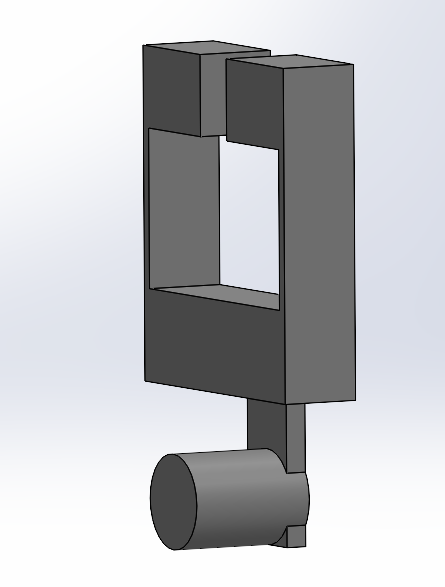
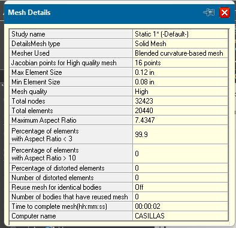
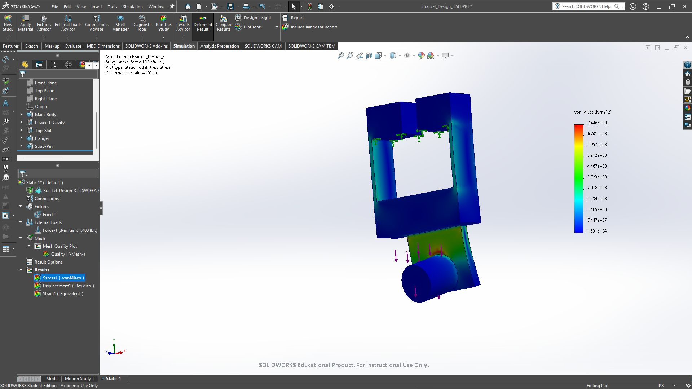
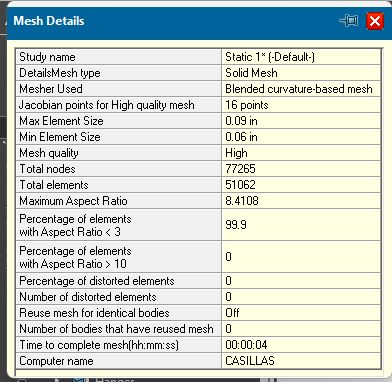
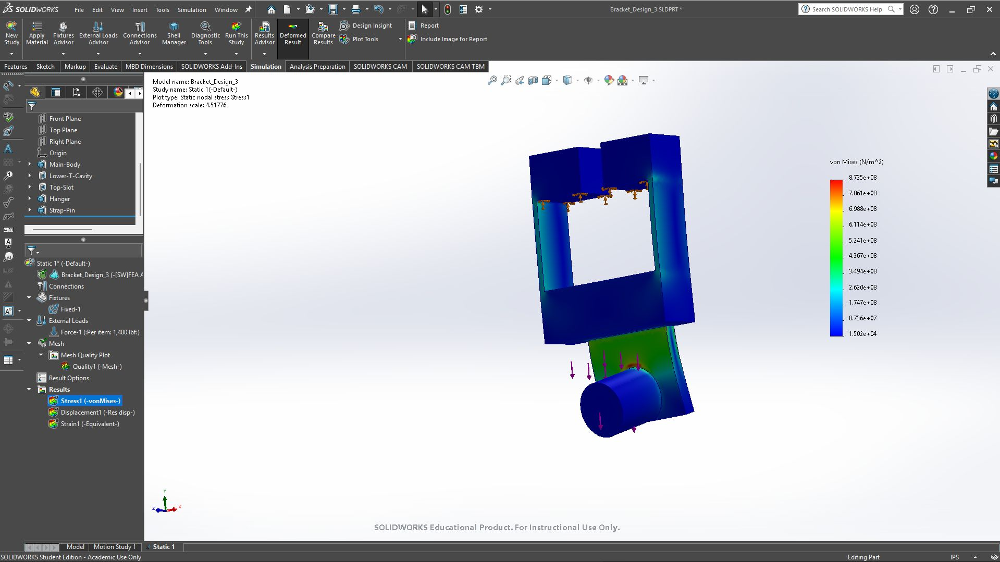
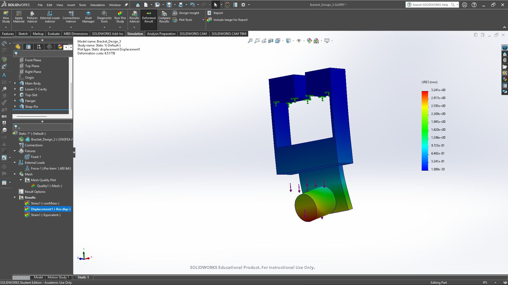
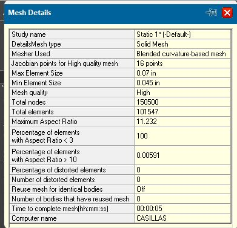

# A7 - Bracket FEA

## Objective

The objective of this assignment is to use finite element analysis to improve the bracket from [Assignment 5](../A05/index.md) and [Assignment 6](../A06/index.md). The bracket transfers the strap load from the cylindrical pin through the hanger and body into the rigid T-shaped support. I used SolidWorks Simulation to examine stress and displacement while refining the mesh.

This page compares the three design iterations and documents the results that can be checked from the available screenshots. Design 3 reached 910.1 MPa maximum von Mises stress and 3.255 mm maximum resultant displacement on the third mesh, with a mass of 0.45 lb. Its last stress and displacement changes are below 7%. The Design 1 and Design 2 results and geometry changes still need their original screenshots before the three designs can be ranked.

## Design Process

**Design Inputs**

The earlier assignments used two 700 lbf strap forces, giving a total load of 1,400 lbf, and selected 6061-T6 aluminum. For this simulation, I confirmed that the load acts straight downward. The Design 3 study tree shows a Fixed-1 fixture and Force-1 labeled “Per item: 1,400 lbf.” The arrows show the load at the pin and the fixture along the upper support region.

The screenshot label is important: it does not by itself establish the total force across every selected entity. The force selection and resultant reaction should be checked in the study before treating the load as a verified total of 1,400 lbf.

The material tree displays FEA Aluminum. I confirmed the material during the workflow, but the material property window and yield strength are not available in the recovered screenshots. The 40 ksi yield strength from Assignment 5 is a prior analytical input, not a verified property of the current Simulation material.

**Inner and Outer Loops**

The inner loop changes the mesh while keeping the geometry, material, load, and fixture the same. The assignment requires stress, displacement, and safety factor to change by no more than 7%, or to use the finest mesh after three attempts. The outer loop changes the geometry based on the results and then repeats the mesh study.

I checked the element count in Mesh Details and changed the element size to refine the mesh. For Design 3, the mesh uses solid elements, a blended curvature-based mesher, and high mesh quality.

## Design 1

**Starting Geometry**

The bracket from Assignment 6 provides the documented starting geometry. It has a T-shaped opening, upper lips, side webs, a lower crossmember, a rear hanger, and a cylindrical pin. The image below is the earlier CAD model for reference; it does not verify the geometry used in the Design 1 simulation.

**Mesh Convergence**

| Attempt | Number of elements | Maximum stress MPa | Maximum displacement mm | Minimum safety factor |
| --- | --- | --- | --- | --- |
| Mesh 1 | Missing | Missing | Missing | Missing |
| Mesh 2 | Missing | Missing | Missing | Missing |
| Mesh 3 if required | Unverified | Unverified | Unverified | Unverified |

The Design 1 screenshots were supplied in the earlier conversation, but they were not available through the recovered attachments. Its mesh convergence, mass, stress location, and displacement location cannot be verified here.

## Design 2

**Geometry Changes**

Design 2 is the second geometry iteration. The exact dimensions changed from Design 1, the reason for each change, and the before-and-after geometry screenshots remain unverified. I have not assigned a specific thickness change, fillet, or material removal without that evidence.

**Mesh Convergence**

| Attempt | Number of elements | Maximum stress MPa | Maximum displacement mm | Minimum safety factor |
| --- | --- | --- | --- | --- |
| Mesh 1 | Missing | Missing | Missing | Missing |
| Mesh 2 | Missing | Missing | Missing | Missing |
| Mesh 3 if required | Unverified | Unverified | Unverified | Unverified |

The Design 2 results and mass need the original screenshots or a study report. Its convergence and improvement over Design 1 cannot be established from the available records.

## Design 3

**Geometry and Setup**

The recovered result plots identify the model as Bracket_Design_3. The visible geometry retains the T opening, side webs, lower crossmember, rear hanger, and pin. The exact dimensional changes from Design 2 are not available, so an improvement caused by a particular geometry change cannot be claimed.

**Mesh 1**

The first mesh contains 20,440 elements and 32,423 nodes. The maximum and minimum element sizes are 0.12 in and 0.08 in. The stress plot reads 7.446 × 10^8 N/m², or 744.6 MPa. The maximum resultant displacement is 3.216 mm.

**Mesh 2**

The second mesh contains 51,062 elements and 77,265 nodes. I reduced the maximum and minimum element sizes to 0.09 in and 0.06 in. The maximum stress increased to 873.5 MPa, while the maximum displacement increased to 3.241 mm.

**Mesh 3**

The third mesh contains 101,547 elements and 150,500 nodes. The maximum and minimum element sizes are 0.07 in and 0.045 in. The latest results are 910.1 MPa maximum stress and 3.255 mm maximum displacement.

**Mesh Convergence**

The mesh-to-mesh percentage change below uses the previous mesh result as the denominator:

**Percentage change = |new result - previous result| / |previous result| × 100**

| Mesh | Maximum size in | Minimum size in | Elements | Maximum stress MPa | Stress change | Maximum displacement mm | Displacement change |
| --- | --- | --- | --- | --- | --- | --- | --- |
| 1 | 0.12 | 0.08 | 20,440 | 744.6 | Initial result | 3.216 | Initial result |
| 2 | 0.09 | 0.06 | 51,062 | 873.5 | 17.31% | 3.241 | 0.78% |
| 3 | 0.07 | 0.045 | 101,547 | 910.1 | 4.19% | 3.255 | 0.43% |

From Mesh 1 to Mesh 2, displacement changed by less than 7%, but stress changed by 17.31%. I therefore used the third mesh. From Mesh 2 to Mesh 3, both stress and displacement changed by less than 7%. Safety-factor convergence remains unverified because no safety-factor plot or confirmed yield strength is available. Mesh 3 is also the finest of the three attempts allowed by the assignment.

The mesh details report zero distorted elements in all three attempts. The third mesh reports a maximum aspect ratio of 11.232 and approximately 0.00591% of elements above an aspect ratio of 10. The peak result still deserves a local mesh and geometry review; the global percentage check alone does not establish that a concentrated peak is physically representative.

**Stress and Displacement Locations**

The stress contours show concentrations near the upper support edges and the pin-to-hanger junction. The precise location of the global 910.1 MPa maximum is unverified because there is no maximum-value marker or probe result. The displacement contours show the largest movement near the free end of the pin, away from the fixed support. That location is a visual interpretation of the contour rather than a recorded node coordinate.

The third-mesh displacement image uses a deformation scale of approximately 4.50. The displayed shape exaggerates the movement; the reported maximum remains 3.255 mm.

**Mass**

The mass-properties window reports 0.45 pounds and a volume of 4.41 cubic inches for Bracket_Design_3. The displayed density is rounded to 0.10 pounds per cubic inch, so it should not be used to reconstruct a more precise mass.

## Three Design Comparison

| Result | Design 1 | Design 2 | Design 3 |
| --- | --- | --- | --- |
| Maximum von Mises stress | Missing | Missing | 910.1 MPa |
| Maximum stress location | Unverified | Unverified | Exact maximum unverified; concentrations at support edges and pin junction |
| Maximum resultant displacement | Missing | Missing | 3.255 mm |
| Maximum displacement location | Unverified | Unverified | Near free end of pin by visual inspection |
| Mass | Missing | Missing | 0.45 lb |
| Minimum safety factor | Missing | Missing | Unverified |
| Number of elements used for comparison | Missing | Missing | 101,547 |
| Mesh convergence | Unverified | Unverified | Stress and displacement pass 7%; safety factor unverified |

**Safety Factor**

The minimum safety factor should be obtained from the Simulation study using its assigned material and failure criterion. If the material yield strength is verified, a separate yield-based estimate can be calculated as yield strength divided by maximum von Mises stress. No numerical safety factor is reported here because the current study's yield strength is unverified.

**Design Decision**

I used the third mesh for the Design 3 result because the stress and displacement changes were below 7%. This establishes the mesh comparison for those two quantities. It does not establish that Design 3 is safe or that it is the strongest, stiffest, or lightest option. The Design 1 and Design 2 results, the assigned yield strength, and the safety-factor result are needed for that decision.

The 910.1 MPa peak also needs to be checked against the verified material yield strength. If the elastic result exceeds yield, the linear static displacement should not be treated as a prediction of post-yield behavior.

## Mistakes and Corrections

**Checking Displacement Alone**

The first refinement changed displacement by only 0.78%, while stress changed by 17.31%. Stopping based on displacement alone would have left the stress result outside the assignment's convergence limit. The third attempt reduced the stress change to 4.19%.

**Stress Units**

The stress legends use N/m². I converted the plotted values to MPa by dividing by 1,000,000. For example, 9.101 × 10^8 N/m² is 910.1 MPa.

**Keeping the Results Matched to the Mesh**

The screenshots identify the same Design 3 study, so I matched the mesh details and result plots by their supplied sequence. Separate study exports would make that association easier to audit. The latest third-mesh values replace the earlier Design 3 values in the final comparison.

## Lessons Learned

**Stress and Displacement Respond Differently to Refinement**

The number of elements increased from 20,440 to 101,547, nearly five times the original count. Across those meshes, maximum stress increased by approximately 22.23%, while maximum displacement increased by approximately 1.21%. The displacement stabilized earlier, so I needed to track both quantities.

**The Load Path Helps Explain the Contours**

The load enters at the pin and passes through the hanger into the body and supported upper region. The stress concentrations around the pin junction and support edges identify areas to examine before making the next geometry change. Adding material or smoothing a transition would need a new analysis before claiming an improvement.

**Convergence and Strength Are Separate Checks**

A small mesh-to-mesh change shows that the reported quantity is becoming less sensitive to that refinement. It does not show that the stress is below yield or that the displacement meets the design requirement. I need the verified material properties and safety-factor result to judge strength.

**Geometry Changes Need Their Own Record**

A useful comparison needs the dimensions changed, the reason for the change, and results obtained under the same loading and support assumptions. Without those records, a lower stress or mass cannot be tied reliably to a particular design choice.

## Time Spent

I spent approximately **4 hours total** on this Bracket FEA assignment, from start to finish. This is the Assignment 7 total, separate from the modeling and drawing time reported in Assignment 6.

## CAD Download Files

[Click to download the **original Assignment 6 Bracket SolidWorks Part**](../A06/Bracket.SLDPRT)

The link above provides the original bracket model. The native Design 1, Design 2, and Design 3 simulation parts have not yet been uploaded to Assignment 7. The original model does not replace those revised files.

## Remaining Documentation

The following files are still needed to complete the evidence for all three designs:

- Native SolidWorks parts for all three iterations, ideally Bracket_Design_1.SLDPRT, Bracket_Design_2.SLDPRT, and Bracket_Design_3.SLDPRT, including their Simulation study setup.
- Design 1 and Design 2 mesh-details, stress, displacement, and mass screenshots or exported study reports for each mesh attempt.
- Before-and-after dimensions or CAD screenshots showing the geometry changes between designs.
- The assigned material's property window with yield strength, minimum safety-factor results, and maximum-value markers for stress and displacement.
- A force-selection or reaction-result screenshot to confirm the total applied load.

The ten recovered Design 3 screenshots are included above. Missing values are left marked rather than replaced with assumed results. This page covers the MEGR 2156 bracket scope; a separate link FEA study would be required for the additional MEGR 2157 portion if assigned.
