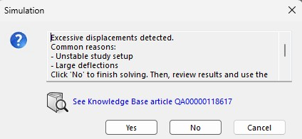
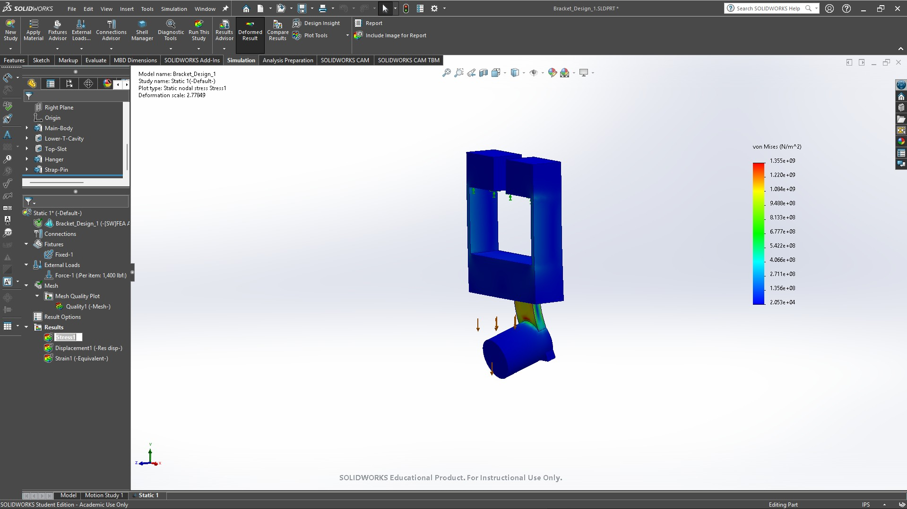
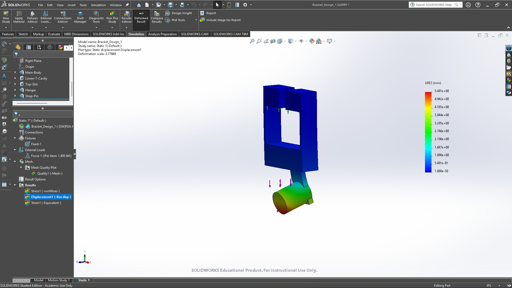
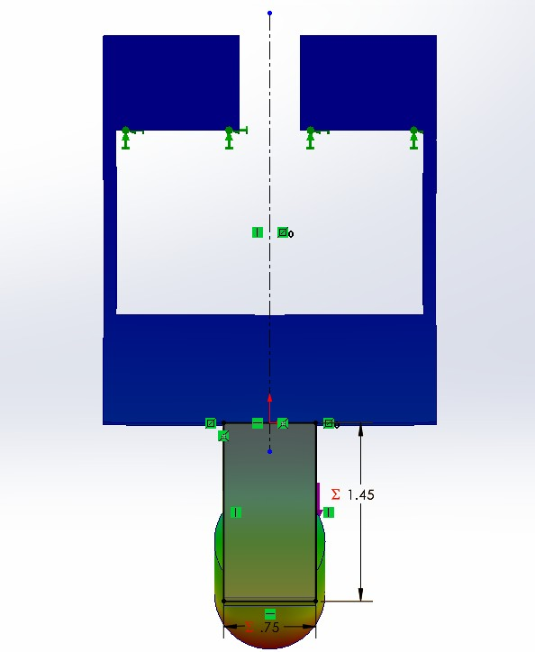
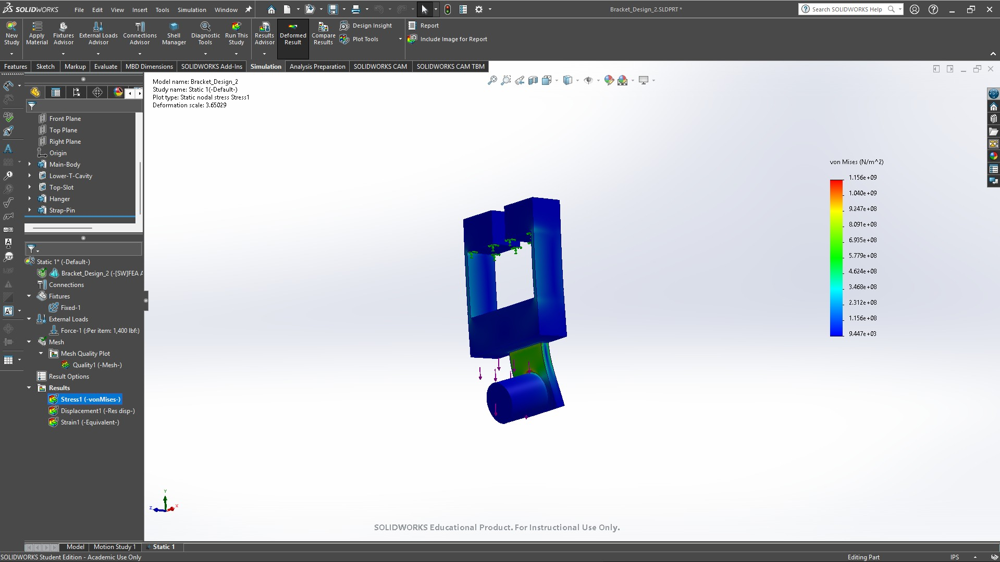
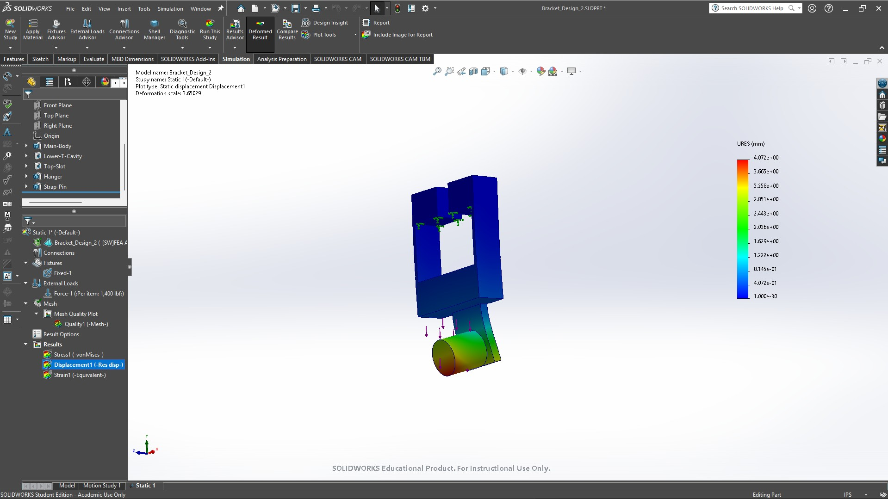
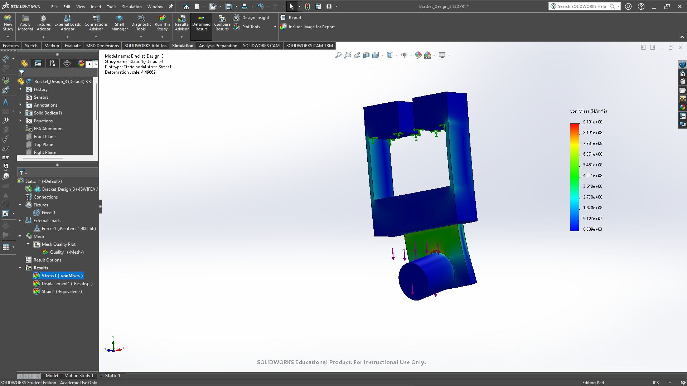
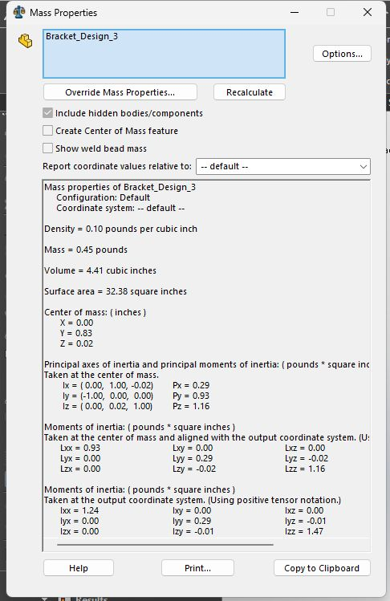

# A7 - Bracket FEA

## Objective

The objective of this assignment is to use finite element analysis to improve the bracket from [Assignment 5](../A05/index.md) and [Assignment 6](../A06/index.md). The bracket transfers the strap load from the cylindrical pin through the hanger and body into the rigid T-shaped support. I used SolidWorks Simulation to examine stress and displacement while refining the mesh.

This page compares the three design iterations and documents the results that can be checked from the available screenshots. Design 3 reached 910.1 MPa maximum von Mises stress and 3.255 mm maximum resultant displacement on the third mesh, with a mass of 0.45 lb. Its last stress and displacement changes are below 7%. Compared with Design 1, Design 3 has approximately 32.83% lower reported maximum stress and 40.72% lower displacement, with a 7.14% mass increase. Material strength and safety factors still need verification.

## Design Process

**Design Inputs**

The earlier assignments used two 700 lbf strap forces, giving a total load of 1,400 lbf, and selected 6061-T6 aluminum. For this simulation, I confirmed that the load acts straight downward. The Design 3 study tree shows a Fixed-1 fixture and Force-1 labeled “Per item: 1,400 lbf.” The arrows show the load at the pin and the fixture along the upper support region.

The screenshot label is important: it does not by itself establish the total force across every selected entity. The force selection and resultant reaction should be checked in the study before treating the load as a verified total of 1,400 lbf.

The material tree displays FEA Aluminum. I confirmed the material during the workflow, but the material property window and yield strength are not available in the recovered screenshots. The 40 ksi yield strength from Assignment 5 is a prior analytical input, not a verified property of the current Simulation material.

**Inner and Outer Loops**

The inner loop changes the mesh while keeping the geometry, material, load, and fixture the same. The assignment requires stress, displacement, and safety factor to change by no more than 7%, or to use the finest mesh after three attempts. The outer loop changes the geometry based on the results and then repeats the mesh study.

I checked the element count in Mesh Details and changed the element size to refine the mesh. For Design 3, the mesh uses solid elements, a blended curvature-based mesher, and high mesh quality.

## Design 1

**Starting Geometry**

Design 1 is the original bracket iteration. The model has a T-shaped opening, upper lips, side webs, a lower crossmember, a rear hanger, and a cylindrical pin. The mass-properties screenshot reports 0.42 lb.

**Mesh Convergence**

| Mesh | Maximum size in | Minimum size in | Elements | Maximum stress MPa | Maximum displacement mm |
| --- | --- | --- | --- | --- | --- |
| 1 | 0.160495 | 0.160495 | 8,852 | 1,307 | 5.434 |
| 2 | 0.1715 | 0.120 | 7,629 | Missing | Missing |
| 3 | 0.120 | 0.080 | 19,059 | 1,355 | 5.491 |

The second attempt has fewer elements than the first, so this is not a consistently finer mesh sequence. Its stress and displacement results were not retained in the supplied archive. Between Mesh 1 and Mesh 3, stress changes by 3.67% and displacement by 1.05%, but those are nonconsecutive comparisons. They do not establish convergence between the final two attempts. I used the finest mesh after three attempts under the assignment's stopping rule.

**Solver Warning**

The initial solve displayed an excessive-displacement warning. The available record does not establish how that warning was resolved or whether large-displacement analysis was enabled. The results below document the reported simulation output; they do not establish that the study assumptions are valid.

**Final Results**

The final stress legend reads 1.355 × 10^9 N/m², or 1,355 MPa. The largest visible stress concentrations are around the pin-to-hanger junction and upper support region. The precise global maximum location needs a probe or maximum-value marker.

The maximum resultant displacement is 5.491 mm, with the greatest visible movement near the free end of the pin. The plotted shape uses an exaggerated deformation scale.

## Design 2

**Geometry Changes**

The supplied archive identifies the hanger and pin region as the area revised to reduce stress and displacement. The dimension screenshot shows a hanger sketch width of 0.75 and a vertical dimension of 1.45. Its unit label and the corresponding Design 1 dimensions are not visible, so the exact dimensional change remains unverified.

**Mesh Convergence**

| Mesh | Maximum size in | Minimum size in | Elements | Maximum stress MPa | Stress change | Maximum displacement mm | Displacement change |
| --- | --- | --- | --- | --- | --- | --- | --- |
| 1 | 0.120 | 0.080 | 19,717 | 960.0 | Initial result | 4.022 | Initial result |
| 2 | 0.090 | 0.060 | 48,990 | 1,055 | 9.90% | 4.056 | 0.85% |
| 3 | 0.070 | 0.045 | 97,579 | 1,156 | 9.57% | 4.072 | 0.39% |

These values come directly from the screenshot legends. The PDF archive's summary table lists different Mesh 1 and Mesh 2 results; the visible plots show 9.600 × 10^8 N/m² and 4.022 mm for Mesh 1, then 1.055 × 10^9 N/m² and 4.056 mm for Mesh 2.

Displacement changes by less than 7% in both refinements. Stress changes by 9.57% between the last two meshes, so it does not meet the 7% criterion. I used Mesh 3 as the finest of three attempts, as allowed by the assignment. Safety-factor convergence remains unverified.

**Final Results**

The final stress is 1,156 MPa and the maximum displacement is 4.072 mm. The stress contours show concentrations around the pin junction and support edges, while the displacement is greatest near the free end of the pin. Exact maximum locations need markers or probe results. A separate Design 2 mass-properties result is not present in the supplied screenshots.

## Design 3

**Geometry and Setup**

The recovered result plots identify the model as Bracket_Design_3. The visible geometry retains the T opening, side webs, lower crossmember, rear hanger, and pin. The exact dimensional changes from Design 2 are not available, so the result differences cannot be tied to a specific thickness or feature change.

**Mesh 1**

The first mesh contains 20,440 elements and 32,423 nodes. The maximum and minimum element sizes are 0.12 in and 0.08 in. The stress plot reads 7.446 × 10^8 N/m², or 744.6 MPa. The maximum resultant displacement is 3.216 mm.

**Mesh 2**

The second mesh contains 51,062 elements and 77,265 nodes. I reduced the maximum and minimum element sizes to 0.09 in and 0.06 in. The maximum stress increased to 873.5 MPa, while the maximum displacement increased to 3.241 mm.

**Mesh 3**

The third mesh contains 101,547 elements and 150,500 nodes. The maximum and minimum element sizes are 0.07 in and 0.045 in. The latest results are 910.1 MPa maximum stress and 3.255 mm maximum displacement.

**Mesh Convergence**

The mesh-to-mesh percentage change below uses the previous mesh result as the denominator:

**Percentage change = |new result - previous result| / |previous result| × 100**

| Mesh | Maximum size in | Minimum size in | Elements | Maximum stress MPa | Stress change | Maximum displacement mm | Displacement change |
| --- | --- | --- | --- | --- | --- | --- | --- |
| 1 | 0.12 | 0.08 | 20,440 | 744.6 | Initial result | 3.216 | Initial result |
| 2 | 0.09 | 0.06 | 51,062 | 873.5 | 17.31% | 3.241 | 0.78% |
| 3 | 0.07 | 0.045 | 101,547 | 910.1 | 4.19% | 3.255 | 0.43% |

From Mesh 1 to Mesh 2, displacement changed by less than 7%, but stress changed by 17.31%. I therefore used the third mesh. From Mesh 2 to Mesh 3, both stress and displacement changed by less than 7%. Safety-factor convergence remains unverified because no safety-factor plot or confirmed yield strength is available. Mesh 3 is also the finest of the three attempts allowed by the assignment.

The mesh details report zero distorted elements in all three attempts. The third mesh reports a maximum aspect ratio of 11.232 and approximately 0.00591% of elements above an aspect ratio of 10. The peak result still deserves a local mesh and geometry review; the global percentage check alone does not establish that a concentrated peak is physically representative.

**Stress and Displacement Locations**

The stress contours show concentrations near the upper support edges and the pin-to-hanger junction. The precise location of the global 910.1 MPa maximum is unverified because there is no maximum-value marker or probe result. The displacement contours show the largest movement near the free end of the pin, away from the fixed support. That location is a visual interpretation of the contour rather than a recorded node coordinate.

The third-mesh displacement image uses a deformation scale of approximately 4.50. The displayed shape exaggerates the movement; the reported maximum remains 3.255 mm.

**Mass**

The mass-properties window reports 0.45 pounds and a volume of 4.41 cubic inches for Bracket_Design_3. The displayed density is rounded to 0.10 pounds per cubic inch, so it should not be used to reconstruct a more precise mass.

## Three Design Comparison

| Result | Design 1 | Design 2 | Design 3 |
| --- | --- | --- | --- |
| Maximum von Mises stress | 1,355 MPa | 1,156 MPa | 910.1 MPa |
| Maximum stress location | Exact maximum unverified | Exact maximum unverified | Exact maximum unverified |
| Maximum resultant displacement | 5.491 mm | 4.072 mm | 3.255 mm |
| Maximum displacement location | Near free end of pin visually | Near free end of pin visually | Near free end of pin visually |
| Mass | 0.42 lb | Missing | 0.45 lb |
| Minimum safety factor | Unverified | Unverified | Unverified |
| Number of elements used for comparison | 19,059 | 97,579 | 101,547 |
| Mesh convergence | Final consecutive comparison unavailable; finest of three attempts | Stress above 7%; finest of three attempts | Stress and displacement pass 7%; safety factor unverified |

The final reported stress decreases by 14.69% from Design 1 to Design 2 and by 21.27% from Design 2 to Design 3. Displacement decreases by 25.84% and 20.06%, respectively. From Design 1 to Design 3, stress decreases by 32.83%, displacement decreases by 40.72%, and mass increases from 0.42 to 0.45 lb, or 7.14%. These are comparisons of reported outputs; the convergence and solver limitations above still apply.

**Safety Factor**

The minimum safety factor should be obtained from the Simulation study using its assigned material and failure criterion. If the material yield strength is verified, a separate yield-based estimate can be calculated as yield strength divided by maximum von Mises stress. No numerical safety factor is reported here because the current study's yield strength is unverified.

**Design Decision**

I used the third mesh for the Design 3 result because the stress and displacement changes were below 7%. This establishes the mesh comparison for those two quantities. Design 3 has the lowest reported stress and displacement of the three iterations. It is heavier than Design 1, and Design 2's mass is missing, so it cannot be identified as the lightest. The material yield strength, safety-factor results, and unresolved Design 1 warning prevent a verified safety conclusion.

The 910.1 MPa peak also needs to be checked against the verified material yield strength. If the elastic result exceeds yield, the linear static displacement should not be treated as a prediction of post-yield behavior.

## Mistakes and Corrections

**Checking Displacement Alone**

The first refinement changed displacement by only 0.78%, while stress changed by 17.31%. Stopping based on displacement alone would have left the stress result outside the assignment's convergence limit. The third attempt reduced the stress change to 4.19%.

**Reading the Source Plots**

The Design 2 archive summary did not match the underlying Mesh 1 and Mesh 2 plot legends. I used the plot values in the convergence table. This changes the conclusion: the final stress change is 9.57%, so Design 2 stops after three attempts rather than meeting the 7% stress criterion.

**Stress Units**

The stress legends use N/m². I converted the plotted values to MPa by dividing by 1,000,000. For example, 9.101 × 10^8 N/m² is 910.1 MPa.

**Keeping the Results Matched to the Mesh**

The screenshots identify the same Design 3 study, so I matched the mesh details and result plots by their supplied sequence. Separate study exports would make that association easier to audit. The latest third-mesh values replace the earlier Design 3 values in the final comparison.

## Lessons Learned

**Stress and Displacement Respond Differently to Refinement**

The number of elements increased from 20,440 to 101,547, nearly five times the original count. Across those meshes, maximum stress increased by approximately 22.23%, while maximum displacement increased by approximately 1.21%. The displacement stabilized earlier, so I needed to track both quantities.

**The Load Path Helps Explain the Contours**

The load enters at the pin and passes through the hanger into the body and supported upper region. The stress concentrations around the pin junction and support edges identify areas to examine before making the next geometry change. Adding material or smoothing a transition would need a new analysis before claiming an improvement.

**Convergence and Strength Are Separate Checks**

A small mesh-to-mesh change shows that the reported quantity is becoming less sensitive to that refinement. It does not show that the stress is below yield or that the displacement meets the design requirement. I need the verified material properties and safety-factor result to judge strength.

**Geometry Changes Need Their Own Record**

A useful comparison needs the dimensions changed, the reason for the change, and results obtained under the same loading and support assumptions. Without those records, a lower stress or mass cannot be tied reliably to a particular design choice.

## Time Spent

I spent approximately **4 hours total** on this Bracket FEA assignment, from start to finish. This is the Assignment 7 total, separate from the modeling and drawing time reported in Assignment 6.

## CAD Download Files

[Click to download the **original Assignment 6 Bracket SolidWorks Part**](../A06/Bracket.SLDPRT)

The link above provides the original bracket model. The native Design 1, Design 2, and Design 3 simulation parts have not yet been uploaded to Assignment 7. The original model does not replace those revised files.

## Remaining Documentation

The following files are still needed:

- Native SolidWorks parts for all three iterations, ideally Bracket_Design_1.SLDPRT, Bracket_Design_2.SLDPRT, and Bracket_Design_3.SLDPRT, including the Simulation study setup.
- Design 2 mass properties and Design 1 Mesh 2 stress and displacement results, if retained.
- Verified before-and-after dimensions for each geometry change, especially Design 2 to Design 3.
- The assigned material property window with yield strength, minimum safety-factor results, and maximum-value markers for stress and displacement.
- A force-selection or reaction-result screenshot to confirm the total applied load, plus the resolution of the Design 1 excessive-displacement warning.

Selected screenshots show the geometry change, Design 1 warning, and final stress and displacement for each design. Mesh details and intermediate result values are recorded in the tables to avoid repeating every screenshot. Missing values remain marked. This page covers the MEGR 2156 bracket scope; a separate link FEA study would be required for the additional MEGR 2157 portion if assigned.
