# A8 – Gearbox Design

## Objective

The objective of this assignment was to design a gearbox that can be assembled and disassembled. I needed to analyze the input and output shafts, choose sleeve bearings, and make a housing to hold the parts together. I then modeled the gearbox in SolidWorks and made the part drawings.

## Design Sketch

I started with a simple sketch showing the two gears inside the housing and the four corner locations for attaching the cover. The side view helped me think about how the shafts would pass through the housing.

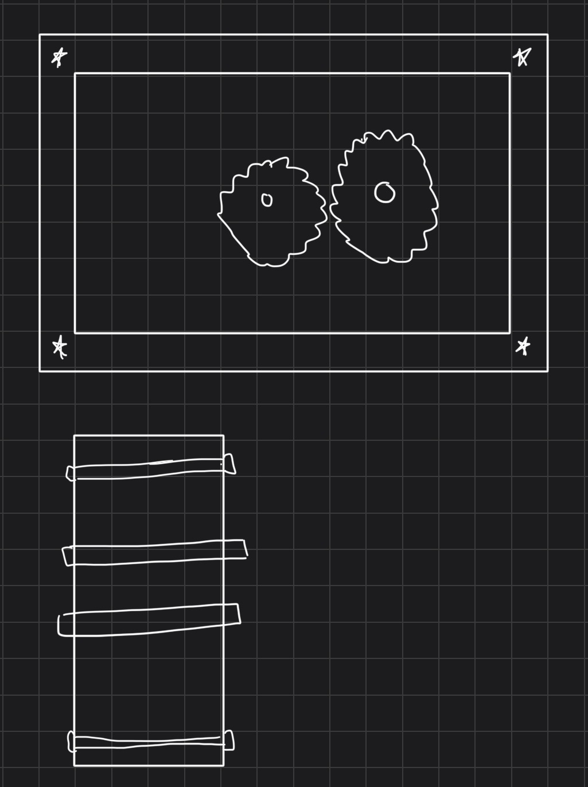

## Shaft Analysis

**Known Values**

The output torque is 1.25 in-lbf at 1,100 rpm. The input shaft diameter is 0.125 in and the output shaft diameter is 0.250 in. Both shafts are 1.000 in long. I used an 18 tooth pinion and a 48 tooth gear, giving the required 24:9 ratio.

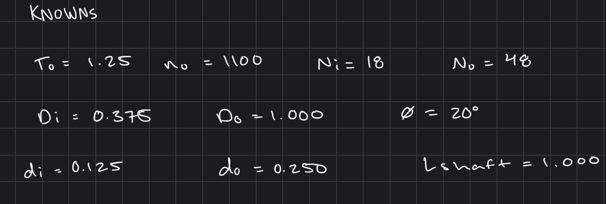

**Gear Ratio and Forces**

I assumed ideal gears with no power loss. The ratio is 48/18 = 2.667, which gives an input speed of 2,933.33 rpm and an input torque of 0.46875 in-lbf. Using the pitch diameters, I calculated a center distance of 0.6875 in.

The tangential force is Ft = 2To/Do = 2(1.25)/1.000 = 2.500 lbf. With a 20 degree pressure angle, the radial force is 0.910 lbf and the resultant gear force is 2.660 lbf.

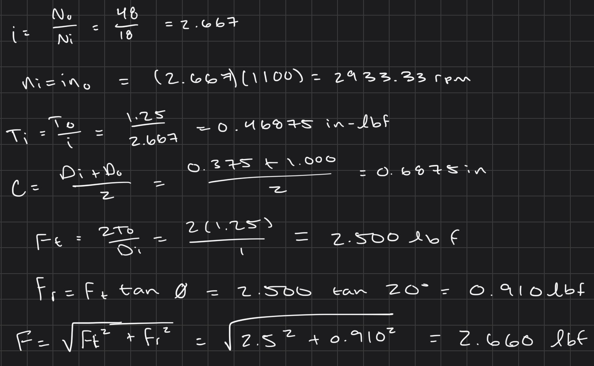

**Free Body Diagrams**

I treated each shaft as a beam supported by two bearings. For the calculation, the gear load is 0.2025 in from the first bearing center and 0.4475 in from the second. This gives a bearing span of 0.650 in. The arrows show the resultant loads in each shaft's bending plane.

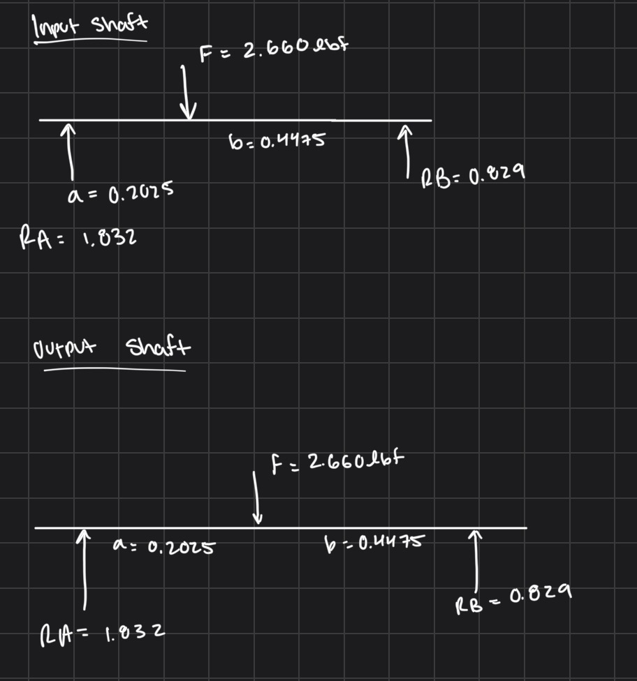

I used force and moment equilibrium to find the bearing reactions. The reactions were approximately 1.832 lbf and 0.829 lbf. The maximum bending moment was 0.3709 in-lbf.

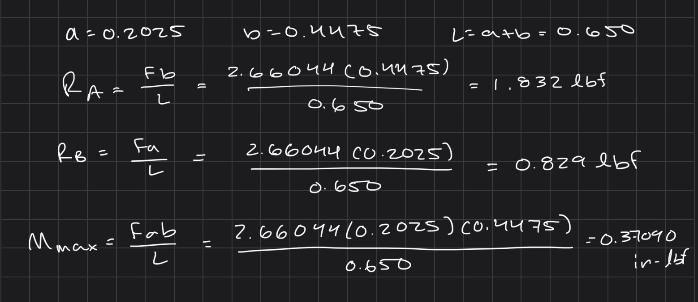

**Shaft Stress**

For the shaft calculation, I used a 90,000 psi yield strength assumption for 1144 stress-relieved steel and a required safety factor of 2. I included bending from the resultant gear force along with torsion. The equations below show the shear stress, bending stress, von Mises stress, and factor of safety.

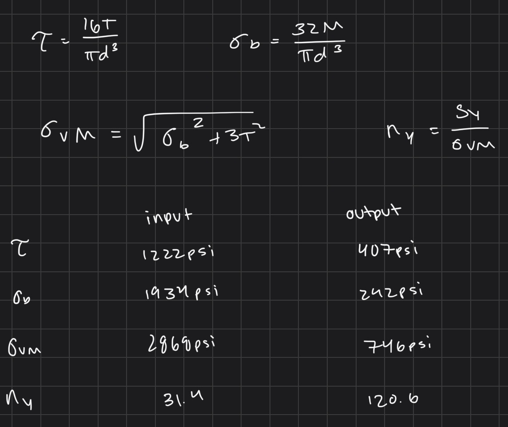

The calculated von Mises stresses were about 2,868 psi for the input shaft and 746 psi for the output shaft. The yield safety factors were about 31.4 and 120.6 for this static loading model.

Solving the same equation for diameter gave minimum values of 0.0499 in and 0.0637 in. The selected 0.125 in and 0.250 in shafts are larger than those values.

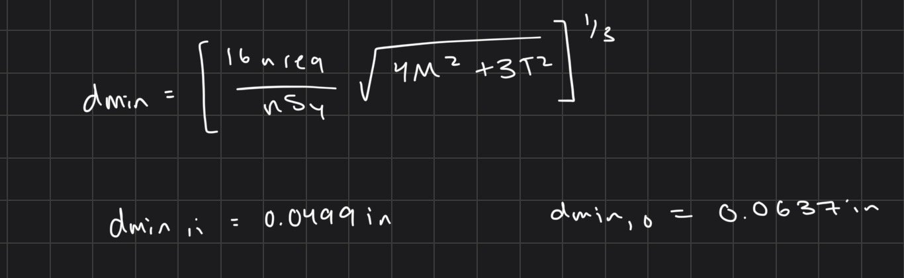

## Bearing Design

**Bearing Selection**

I selected two McMaster 6391K111 sleeve bearings for the input shaft and two 6391K131 bearings for the output shaft. These are oil-embedded SAE 841 bronze bearings, and both sizes are 0.250 in long.

I used a design load of 4 lbf per bearing, which is higher than the calculated reactions. I checked bearing pressure, surface velocity, and PV using the equations below.

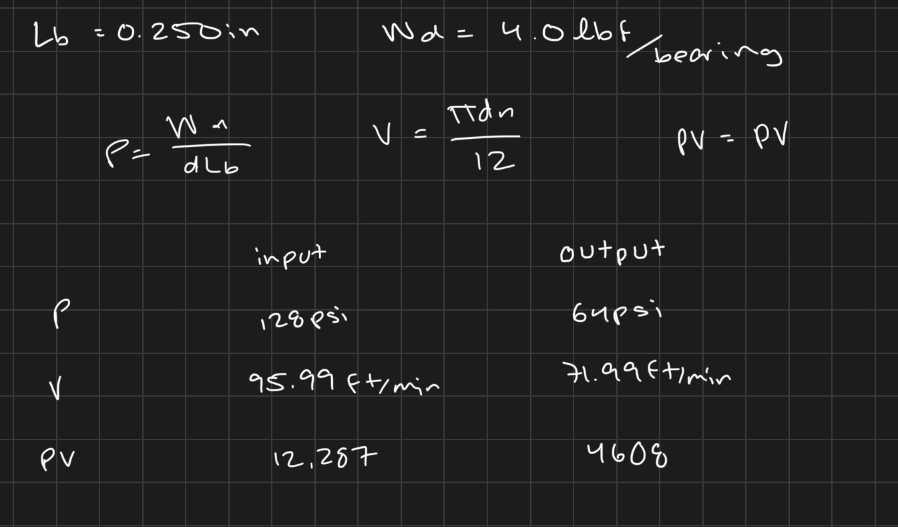

The input bearing pressure was 128 psi and the output pressure was 64 psi. Their surface velocities were about 95.99 ft/min and 71.99 ft/min. The PV values were about 12,287 and 4,608 psi-ft/min.

These are below the listed limits of 2,000 psi pressure, 1,200 ft/min velocity, and 50,000 psi-ft/min PV for the selected bearings.

**Minimum Bearing Length**

I compared the length required by pressure with the length required by PV and used the larger result. The minimum lengths were 0.0614 in for the input and 0.0230 in for the output. Both are below the selected 0.250 in bearing length.

The equations used were Lmin = max[W/(d Pmax), W pi n/(12 PVmax)], with shaft diameter in inches and speed in rpm.

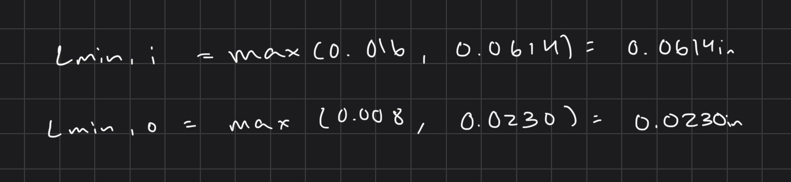

**Bearing Wall Thickness**

For a preliminary wall thickness check, I used twice the calculated bearing pressure and an assumed allowable stress of 5,000 psi. This is a simplified thickness model, with the allowable stress treated as a design assumption.

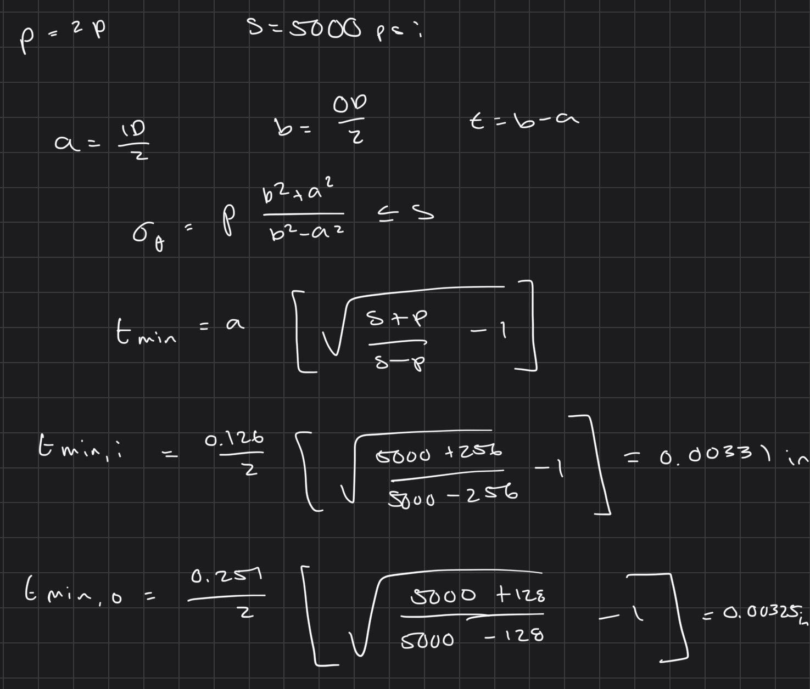

The calculated minimum wall thicknesses were about 0.00331 in and 0.00325 in. Using the smallest outside diameter and largest inside diameter from the bearing dimensions gave available wall thicknesses of 0.0625 in and 0.0620 in.

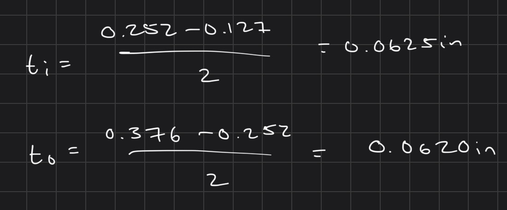

The bearings need to stay fixed in the housing while the shafts rotate inside them. For that fit, I used a proposed housing interference of 0.0002–0.0004 in based on the measured bearing outside diameter, and a target installed shaft clearance of 0.0006–0.0022 in. These fits depend on the installed bearing bore, so they use closer dimensions than the general drawing tolerance.

## CAD Modeling

**Housing and Cover**

I made the main housing from a 1.900 in by 1.500 in rectangle and extruded it 0.650 in. I cut the inside cavity and left material around the sides and at the four corner bosses. I then added the bearing openings and the holes for attaching the cover.

The input shaft center is 0.450 in from the left edge and the output center is 1.1375 in from the same edge. Both centers are 0.750 in from the bottom. This keeps the shaft spacing at the calculated 0.6875 in.

I made the cover as a separate part with a thickness of 0.250 in. The bearing openings and screw clearance holes line up with the housing. The stop boss on the inside of the cover extends toward the input gear.

**Assembly**

I added the shafts, sleeve bearings, and gears to the housing assembly. The smaller gear is on the input shaft and the larger gear is on the output shaft. This view shows the arrangement with the cover removed.

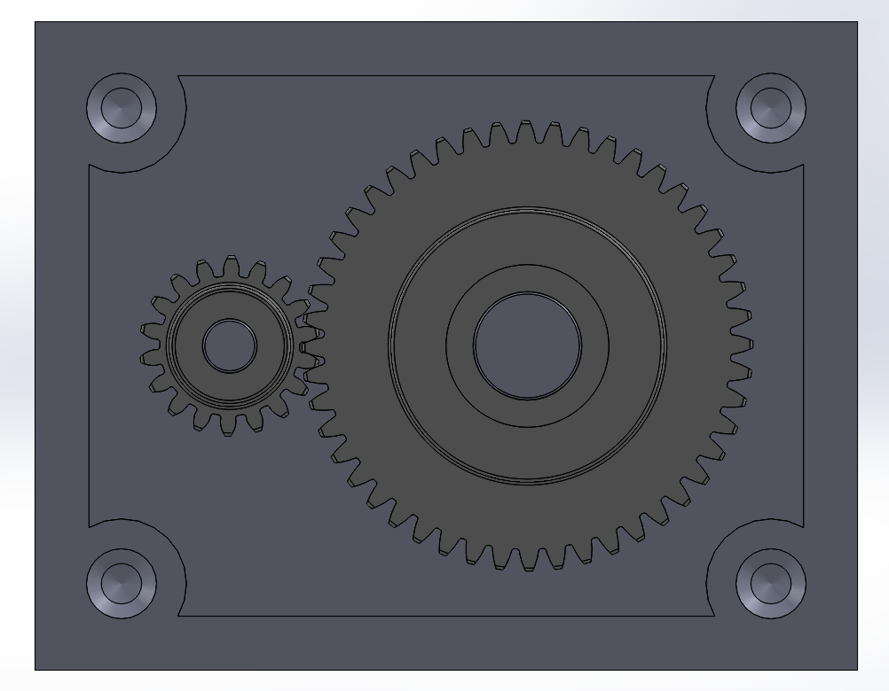

I used a gear mate with the 18 and 48 tooth values to relate the two gears.

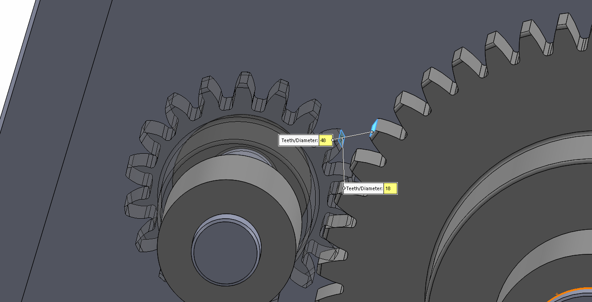

After adding the cover, the gearbox looked like this.

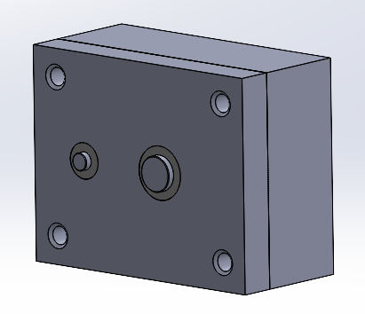

## Drawings

I made the part drawings from the SolidWorks models and reused the sheet setup for the other parts. The views show the shaft sizes, sleeve bearings, housing, and cover. I saved the sheets together as a PDF.

[Click to download **Gearbox Drawings PDF**](gearbox_drawings.pdf)

## Lessons Learned

One thing that confused me was which face to use for the corner bosses and cover holes. I learned to check the face and the dimension references before making the feature, since the same dimension can place a hole differently depending on the edge selected.

The input shaft stop boss also confused me at first because it looked like a separate piece. It extends from the inside of the cover, so it needs to stay connected to the cover when it is extruded.

I also learned that choosing a bearing is more than matching the shaft diameter. The pressure, speed, PV, and wall thickness all need to be checked. Reusing the drawing sheet setup helped me save time when making the drawings for the different parts.

## Time Spent

I spent approximately 7 hours on this assignment, including the calculations, CAD models, assembly, and drawings.

## CAD Download Files

[Click to download **Gearbox SolidWorks Assembly File**](gearbox.SLDASM)

[Click to download **Gearbox Drawings PDF**](gearbox_drawings.pdf)

## Sources Used

[McMaster input pinion – 7880K19](https://www.mcmaster.com/7880K19/)

[McMaster output gear – 7880K24](https://www.mcmaster.com/7880K24/)

[McMaster input sleeve bearing – 6391K111](https://www.mcmaster.com/6391K111/)

[McMaster output sleeve bearing – 6391K131](https://www.mcmaster.com/6391K131/)

[Gearbox assignment reference portfolio](https://gracieanne14.github.io/design-projects-portfolio/assignments/A08/)
