# A9 – Pulley Drive

## Objective

The objective was to analyze a pulley drive by working through the belt, shaft, journal bearings, and frame. I organized the calculations below with the known values, equations, and results from my handwritten notes.

## Belt

**Known Values and Assumptions**

I used two equal 3.00 in pulleys with a center distance of 5.00 in, a speed of 1,500 rpm, and an initial belt tension of 5.00 lbf. My notes assume T1/T2 = 2 and T1 + T2 = 2T0. The belt strength value used is 471 psi, with a required safety factor of 3. The material and source of that strength value still need to be confirmed.

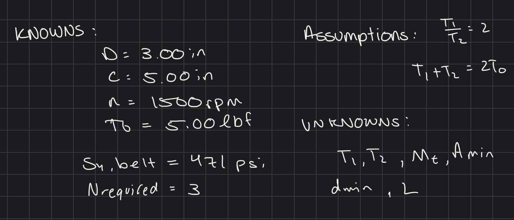

**Free Body Diagram and Belt Tensions**

The diagram shows both belt tensions acting on the pulley, with the shaft reaction opposing their sum. The pulley radius is 1.50 in.

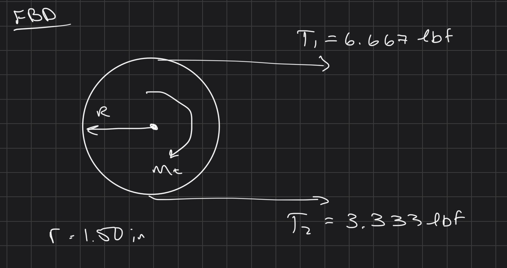

Using T1 = 2T2 and T1 + T2 = 10 lbf gives T2 = 3.333 lbf and T1 = 6.667 lbf.

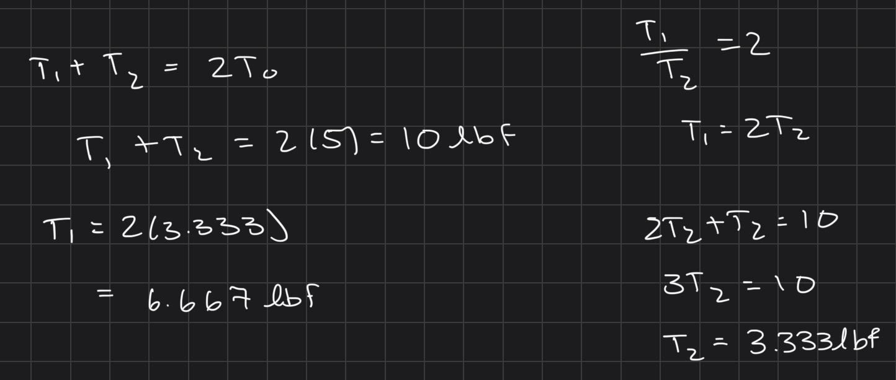

The transmitted torque is Mt = (T1 − T2)r = 5.00 in-lbf using unrounded tensions. The radial load is R = T1 + T2 = 10.00 lbf.

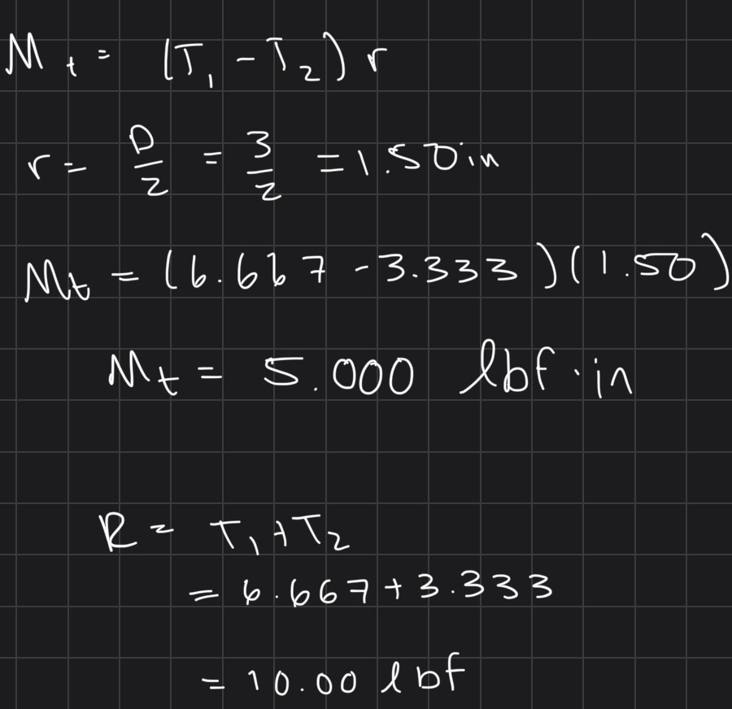

The curved torque arrow in the sketch points in the same direction as the net belt moment. For a steady-speed free body diagram of the pulley, the balancing shaft torque should point in the opposite direction. This does not change the torque magnitude used below.

**Belt Cross-Section**

Using the strength assumption in my notes, σallow = 471/3 = 157 psi.

Amin = T1/σallow ≈ 0.04246 in²

For a round belt, dmin = √(4Amin/π) ≈ 0.2325 in. I selected a 0.250 in cross-section diameter, giving A = π(0.250)²/4 ≈ 0.04909 in².

The tight-side tensile stress is σmax = T1/A ≈ 135.8 psi.

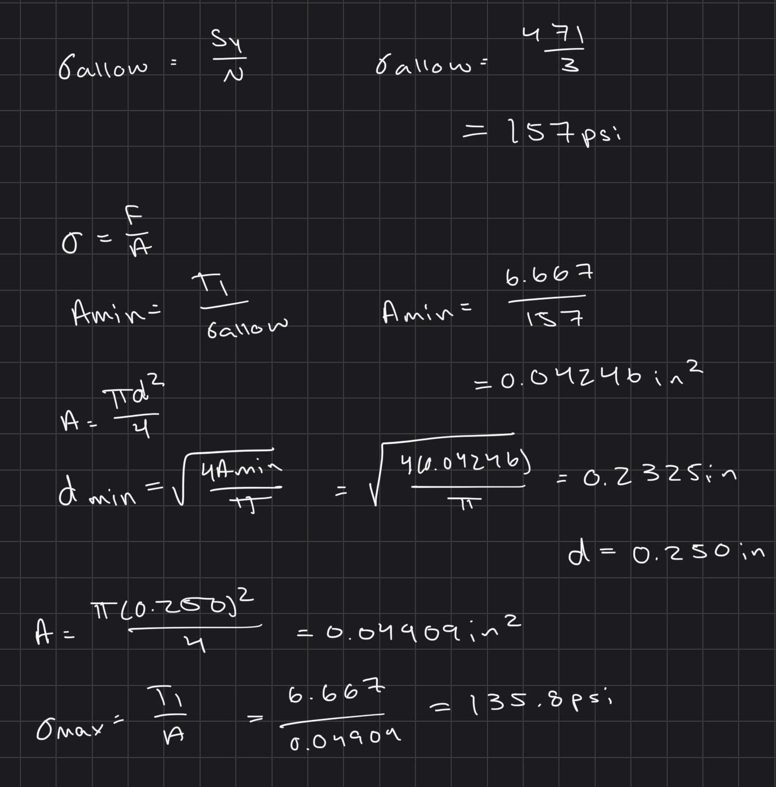

The resulting tensile safety factor is N = 471/135.8 ≈ 3.47, above the required value of 3 for this simplified calculation.

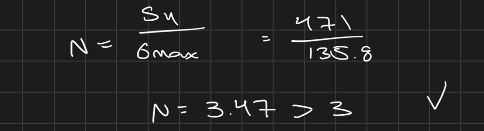

This check uses the stated 471 psi strength as an assumption. It does not establish a manufacturer's rating or account for bending fatigue, creep, centrifugal tension, or a belt joint.

**Belt Length and Speed**

For equal pulleys in an open-belt arrangement:

L = 2C + πD = 2(5) + π(3) ≈ 19.425 in

v = πDn/12 = π(3)(1,500)/12 ≈ 1,178.1 ft/min

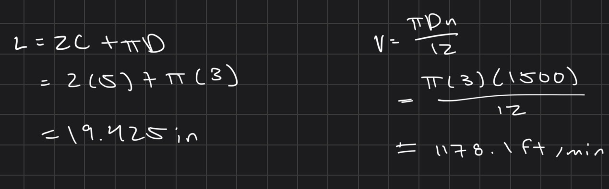

These equations treat the 3.00 in diameter as the effective belt pitch diameter. The length is the installed pitch-path length, not automatically the relaxed circumference of a purchased belt. Groove geometry and stretch would affect the final belt selection.

**Power and Friction**

The difference between belt tensions transmits power:

P = (T1 − T2)v/33,000 ≈ 0.119 hp

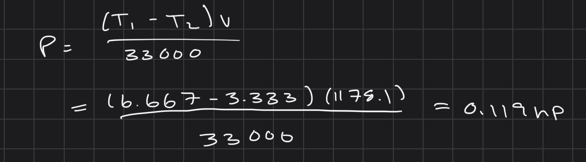

With equal pulleys, the ideal wrap angle is π radians. The friction equation gives:

T1/T2 ≤ exp(μθ)

μmin = ln(2)/π ≈ 0.221

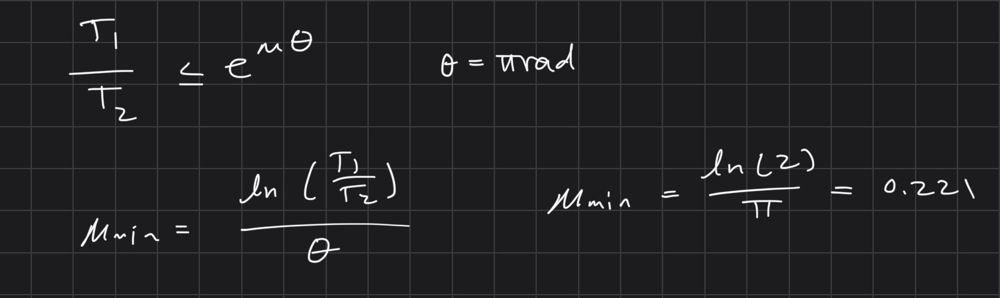

This is the minimum friction coefficient for the stated tension ratio in the simplified model. The actual belt and pulley friction has not been measured or verified. A specific belt material and part have not been identified in these notes.

## Shaft

**Known Values and Free Body Diagram**

My shaft notes use a torque of 5.00 in-lbf, a speed of 1,500 rpm, a yield strength of 85,000 psi, and a required safety factor of 3. The transverse load used later is 10 lbf. The yield strength is treated as an assumption until the shaft material and condition are confirmed.

The first sketch represents equal and opposite applied torques. The arrows along the shaft are torque labels, not additional axial forces.

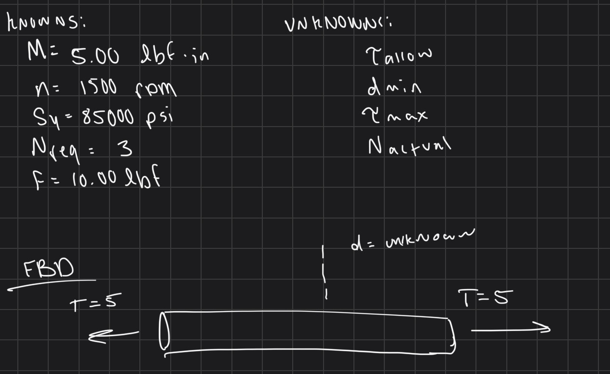

**Torsion Calculation**

For a solid circular shaft:

J = πd⁴ / 32

τmax = Tc / J = 16T / (πd³)

Using the von Mises criterion for pure torsion, the allowable shear stress is:

τallow = Sy / (√3 N) = 85,000 / (√3 × 3) ≈ 16,358 psi

Solving for the minimum diameter gives dmin ≈ 0.116 in. I used a shaft diameter of 0.375 in in the following calculations.

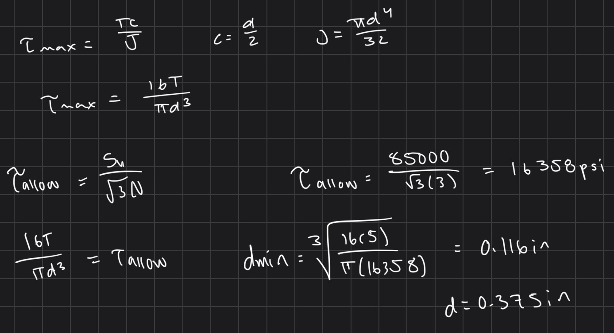

For d = 0.375 in, the shear stress is approximately 483 psi and the torsion-only yield safety factor is 101.6.

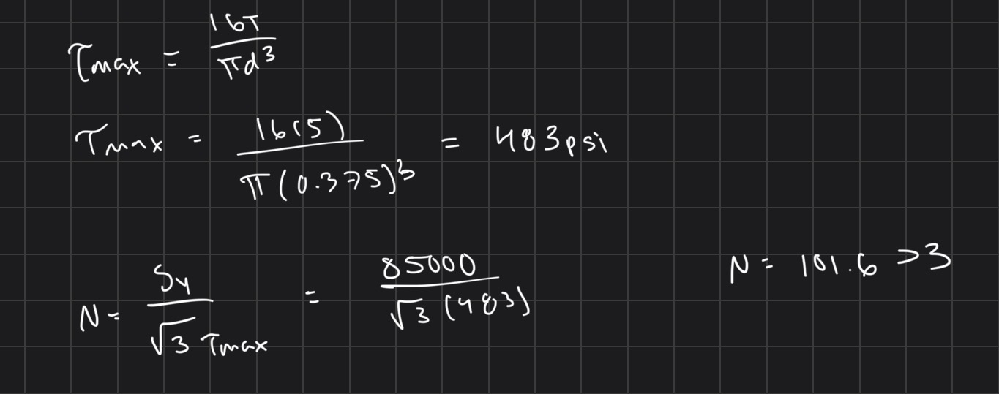

**Combined Bending and Torsion**

The bearing model below places the 10 lbf load halfway between supports 2.00 in apart. This gives Mmax = Fs / 4 = 5.00 in-lbf.

The bending stress is σb = 32M / (πd³) ≈ 966 psi. Combining bending and torsion gives:

σVM = √(σb² + 3τ²) ≈ 1,278 psi

N = Sy / σVM = 85,000 / 1,278 ≈ 66.5

The combined result is lower than the torsion-only safety factor and is the relevant static yield check for this loading model. It exceeds the required value of 3 under the stated assumptions. These calculations do not check rotating-shaft fatigue, stress concentrations, shaft deflection, or shock loads.

The combined calculation is shown in the screenshot at the end of the journal bearing section, which also contains the PV result.

## Journal Bearing

**Known Values and Free Body Diagram**

I used a 0.375 in shaft diameter, a 2.00 in bearing span, and a bearing length of 0.500 in. The shaft speed is 1,500 rpm. The model assumes two simple supports with the 10 lbf pulley load centered between them.

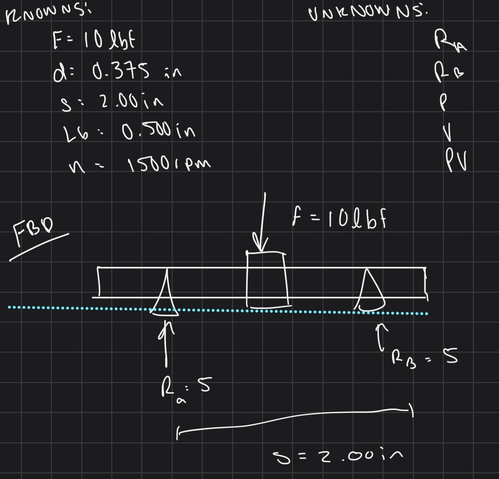

**Bearing Reactions**

From force equilibrium, RA + RB = 10 lbf.

Taking moments about A gives RB(2) − 10(1) = 0. Therefore, RA = RB = 5.00 lbf.

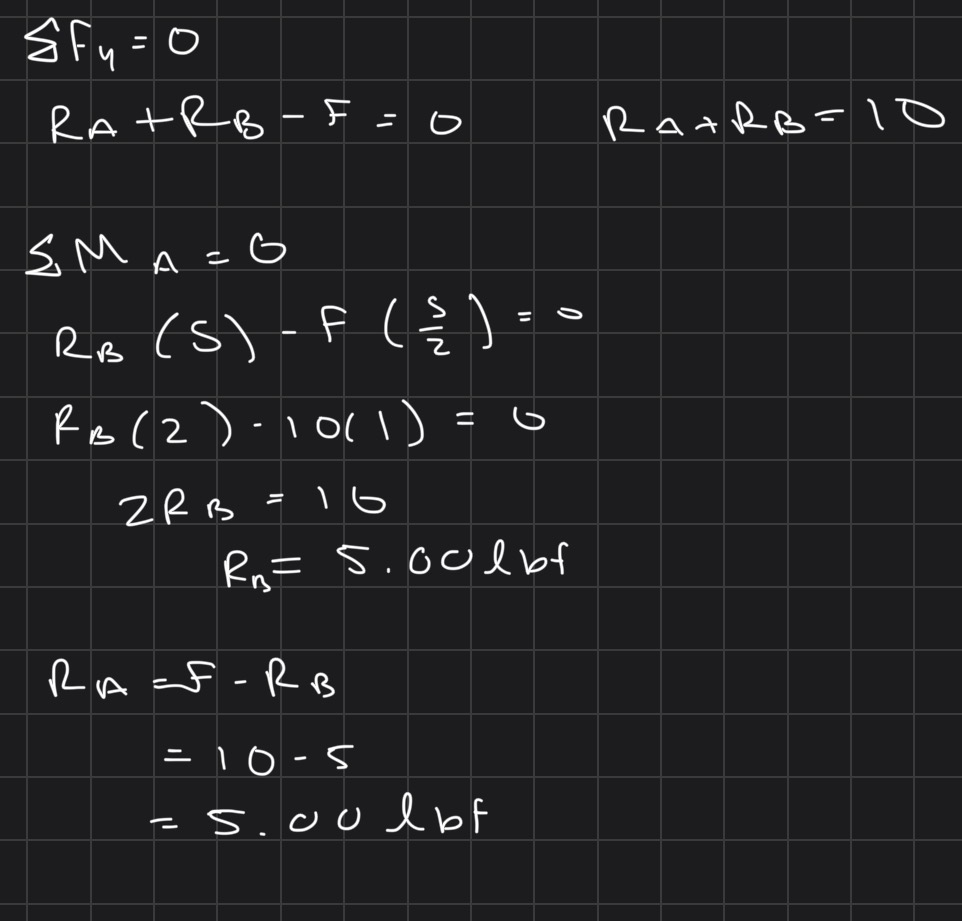

**Pressure, Velocity, and PV**

The projected area of each bearing is Ap = dLb = 0.375(0.500) = 0.1875 in².

The pressure on each bearing is p = R / Ap = 5 / 0.1875 ≈ 26.67 psi.

The shaft surface velocity is v = πdn / 12 = π(0.375)(1,500) / 12 ≈ 147.26 ft/min.

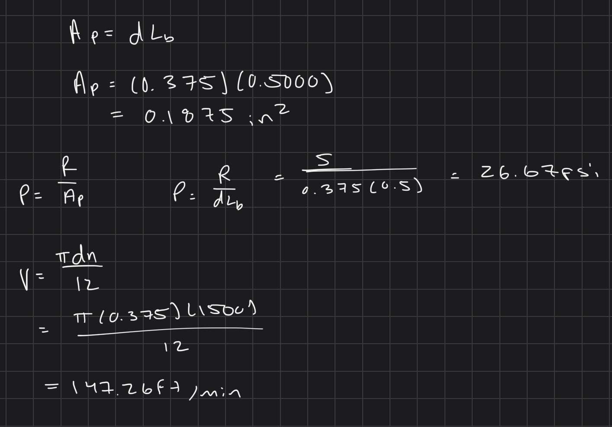

PV = pv ≈ 3,927 psi-ft/min.

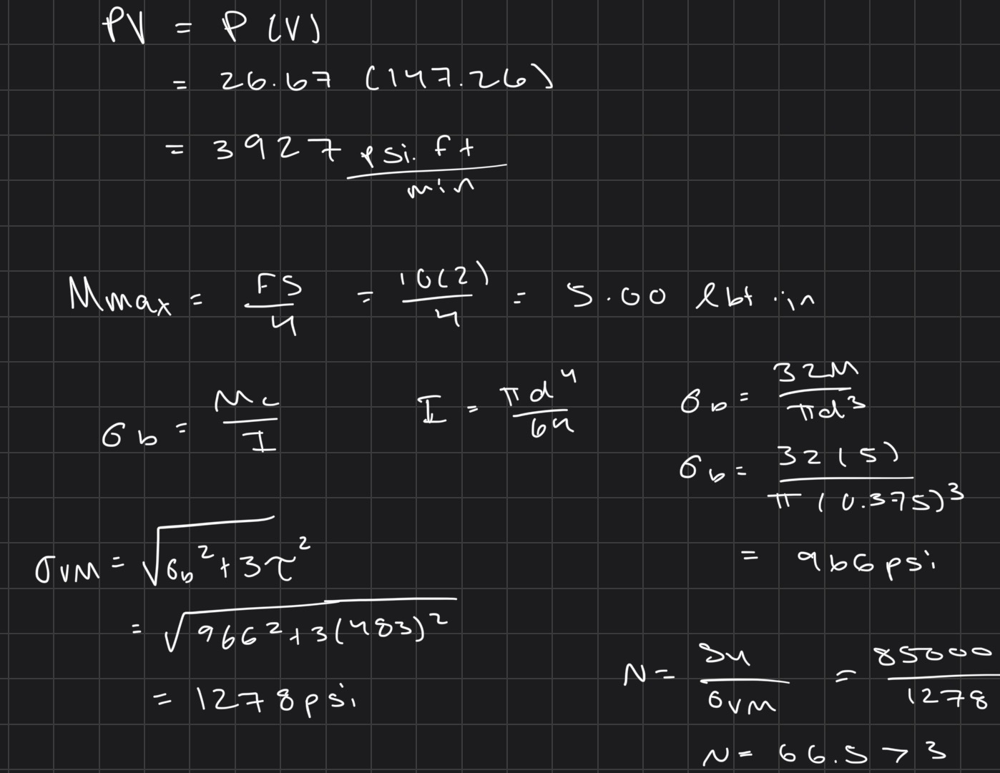

These values describe the operating demand. A bearing material or part cannot be approved from these numbers alone. Its allowable pressure, speed, and PV must be checked for the intended lubrication and operating conditions. The available screenshots do not identify a verified bearing rating, fit, or clearance.

## Frame

The available frame calculation uses a 2.00 in width, a 0.250 in thickness, and a 5 lbf load. The assumed yield strength is 35,000 psi, with a required safety factor of 3.

A = wt = 2.00(0.250) = 0.500 in²

σ = F / A = 5 / 0.500 = 10.0 psi

σallow = Sy / 3 = 35,000 / 3 ≈ 11,667 psi

The nominal direct-stress safety factor is 35,000 / 10 = 3,500.

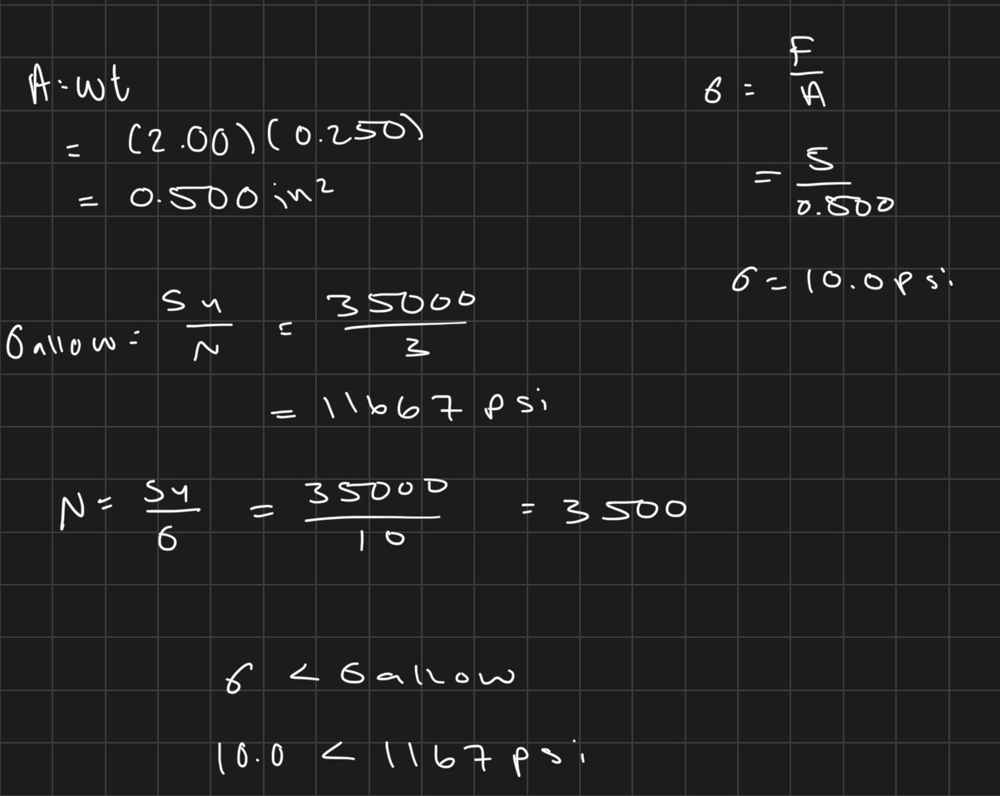

This result only covers direct stress on the assumed area. It does not establish the safety factor of the whole frame. The frame sketch and load path are still needed to check whether the load causes bending, and to assess deflection, connections, and local bearing loads. The frame material also needs to be confirmed.

## Lessons Learned

The calculations show why the belt tension difference and the load on the shaft have different roles. The tension difference transfers power, while the belt forces also load the shaft and its supports.

The shaft results also show why checking torsion alone is not enough. Including bending reduces the calculated yield safety factor from about 101.6 to 66.5.

For the journal bearings, calculating pressure, surface velocity, and PV is only part of the selection process. Those results still need to be compared with the ratings for the actual bearing. The frame calculation makes a similar point: a low direct stress does not replace a check of how the complete frame carries the load.

## Details Still to Verify

- Confirm the belt material, the source of the 471 psi strength, friction, and the purchased belt size for the calculated pitch-path length.
- Confirm the shaft material supporting the assumed 85,000 psi yield strength.
- Confirm the bearing selection and its pressure, speed, PV, lubrication, and fit limits.
- Add the frame sketch and confirm its material, load path, and any needed bending or connection checks.

## Notes Included

This page includes all 17 supplied screenshots: IMG_0351–IMG_0354 and IMG_0356–IMG_0368. The filename sequence skips IMG_0355; no content has been assumed for that number.

## Reference

[Pulley assignment structural reference](https://gracieanne14.github.io/design-projects-portfolio/assignments/A09/#lessons-learned)

The reference was used for section organization only. The numerical results above come from my handwritten screenshots, with arithmetic checked separately.
