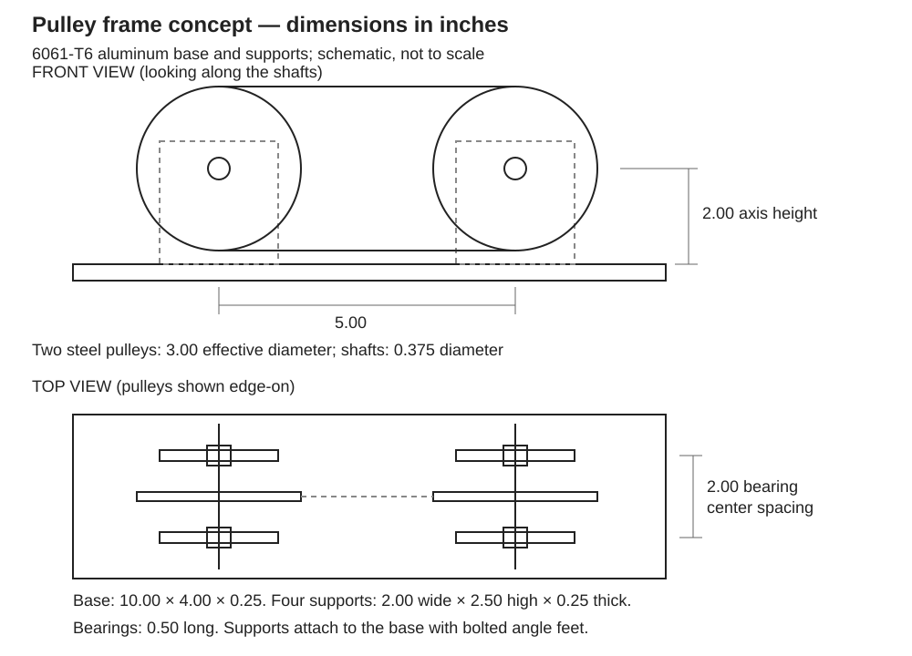

# A9 – Pulley Drive

## Objective

The objective of this assignment was to analyze a pulley drive, including the belt, shaft, journal bearings, and frame. I used a required safety factor of 3.

## Belt

I started with two 3 in pulleys, a 5 in center distance, a speed of 1,500 rpm, and an initial belt tension of 5 lbf. I assumed a tension ratio of 2 and a belt strength of 471 psi.

Using T1 + T2 = 2T0 and T1 = 2T2, I calculated tensions of 6.667 lbf and 3.333 lbf.

The tension difference produces a torque of 5 in-lbf. Adding the tensions gives a 10 lbf load on the shaft.

I calculated a minimum round belt diameter of 0.2325 in and selected 0.250 in. This gives a tensile stress of 135.8 psi and a safety factor of 3.47 using the assumed strength.

Using the 3 in pulley diameter as the effective belt diameter, I calculated a belt path length of 19.425 in and a belt speed of 1,178.1 ft/min.

The transmitted power is approximately 0.119 hp.

For a wrap angle of 180 degrees, the minimum friction coefficient is approximately 0.221.

**Belt Selection**

For the proposed drive, I selected 1/4 in [Fenner Eagle Hyfen 85 R polyurethane belting, 5218012](https://catalog.fenner.com/item/eagle-polyurethane/6mm-1-4-round-cross-sections/5218012), with steel pulleys. Its minimum pulley diameter is 2.75 in, below my 3 in design. The listed friction coefficient on steel is 0.60, above the calculated 0.221.

The catalog gives 3.7 lbf at 1% tension and 12.4 lbf at 2%; the 5 lbf initial tension and 6.667 lbf tight-side tension fall between those points. I would set the fitted loop to the 5 lbf initial tension. The 19.425 in value is the installed path length. My handwritten 471 psi value is an initial sizing assumption, not this reinforced belt's rated strength; the 3.47 result applies only to that original model.

## Shaft

I selected [1144 Stressproof cold-finished steel](https://www.onlinemetals.com/en/product-guide/alloy/1144) for the shafts. The supplier lists a yield strength of 89,900 psi. I kept the lower 85,000 psi design value and the 5 in-lbf torque in my calculations.

The torsion calculation gave a minimum diameter of 0.116 in. I selected a 0.375 in shaft.

The torsional shear stress is approximately 483 psi, giving a torsion-only safety factor of 101.6.

I also included bending from the centered 10 lbf pulley load. With a 2 in bearing span, the maximum bending moment is 5 in-lbf. The combined bending and torsion stress is approximately 1,278 psi, giving a static yield safety factor of 66.5. This calculation is shown with the bearing PV calculation below.

## Journal Bearing

I used two bearings with a 0.375 in shaft diameter and a bearing length of 0.500 in. I placed the pulley load halfway between the supports.

Using force and moment equilibrium, I calculated a reaction of 5 lbf at each bearing.

The projected bearing area is 0.1875 in². This gives a bearing pressure of 26.67 psi and a surface velocity of 147.26 ft/min.

Multiplying pressure by velocity gives a PV value of approximately 3,927 psi-ft/min.

**Bearing Selection**

I selected four [McMaster 6391K173 oil-embedded SAE 841 bronze sleeve bearings](https://www.mcmaster.com/product/6391K173/), two per shaft. Each is for a 3/8 in shaft, a 1/2 in housing bore, and is 1/2 in long.

| Check | Calculated | Catalog limit |
| --- | ---: | ---: |
| Pressure | 26.67 psi | 2,000 psi |
| Surface velocity | 147.26 ft/min | 1,200 ft/min |
| PV | 3,927 psi-ft/min | 50,000 psi-ft/min |

All three calculated values are below the listed limits.

## Frame

I selected 6061-T6 aluminum for the frame, using a 35,000 psi design yield strength, below the [supplier's listed T6 value of 40,000 psi](https://www.onlinemetals.com/en/product-guide/alloy/6061). My first calculation uses a 2 in wide, 0.250 in thick section carrying 5 lbf.

The cross-sectional area is 0.500 in², giving a direct stress of 10 psi. The allowable stress is 11,667 psi with a safety factor of 3. The calculated safety factor for this direct-stress model is 3,500.

**Frame Layout**

I laid out a 10 × 4 × 0.25 in base with four 2 in wide, 2.5 in high supports. The shaft centers are 5 in apart and 2 in above the base. The two bearings on each shaft are 2 in apart, with the pulley centered between them. Bolted angle feet attach the supports to the base.

For bending in the plane of each support, I modeled the base as fixed and applied 5 lbf at a height of 2 in. This gives M = 10 in-lbf and I = 0.25(2³)/12 = 0.1667 in⁴. The nominal bending stress is 60 psi, giving a section yield safety factor of about 583. This is an idealized support-section check, not a complete joint or assembly rating.

## Lessons Learned

The tension difference determines the transmitted torque, while the sum of the tensions determines the load on the shaft. Including bending also gives a lower shaft safety factor than checking torsion alone. The bearing calculations show how load, contact area, and speed affect pressure and PV.
