# A10 – Lead Screw Translating System

## Objective
The objective of this assignment is to design a mechanically operated tensile testing system using two lead screws capable of applying a maximum axial tensile load of 2 kN with a controlled crosshead speed of 1–50 mm/min. The design process involves determining the appropriate lead screw diameter, rotational speed, and torque while maintaining a safety factor of 4. Additionally, the project includes selecting suitable nuts and flanges, designing a crosshead that meets strength and deflection requirements, and creating a complete CAD assembly in SolidWorks. The overall goal is to develop a safe, reliable, and accurate tensile testing system while applying engineering calculations, material selection, and mechanical design principles.

## Analyze

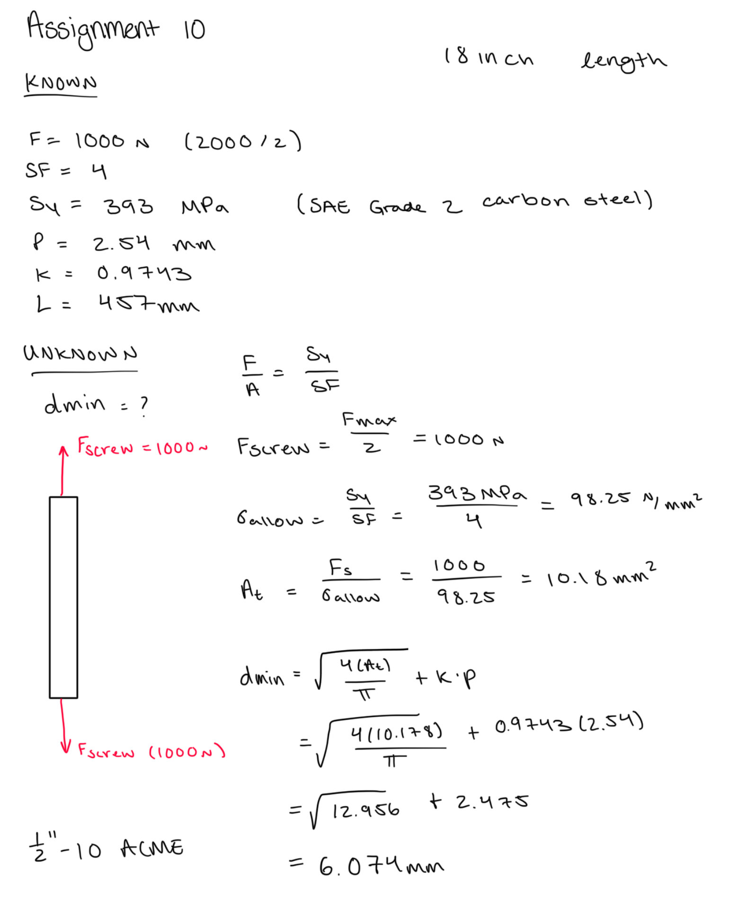

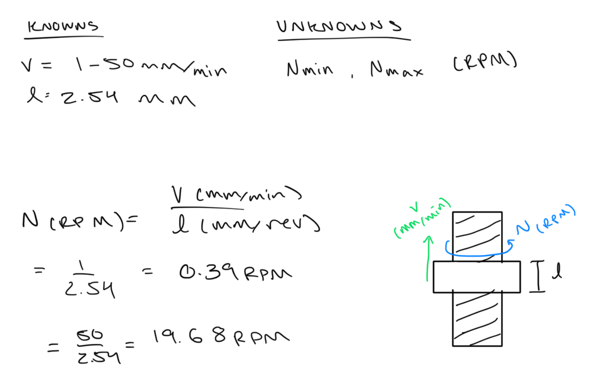

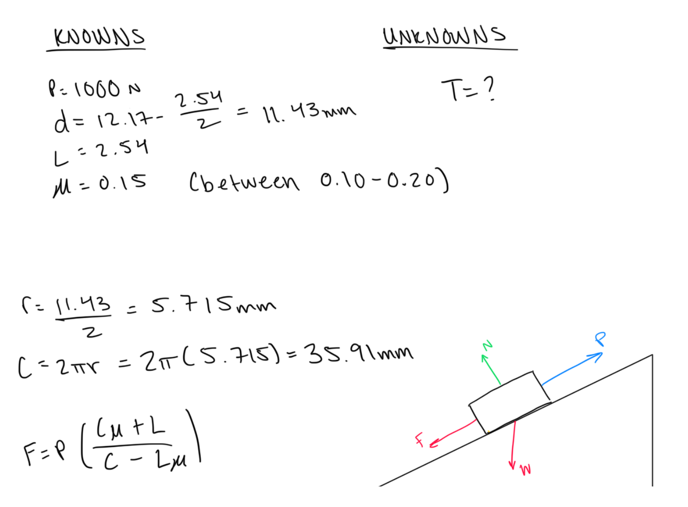

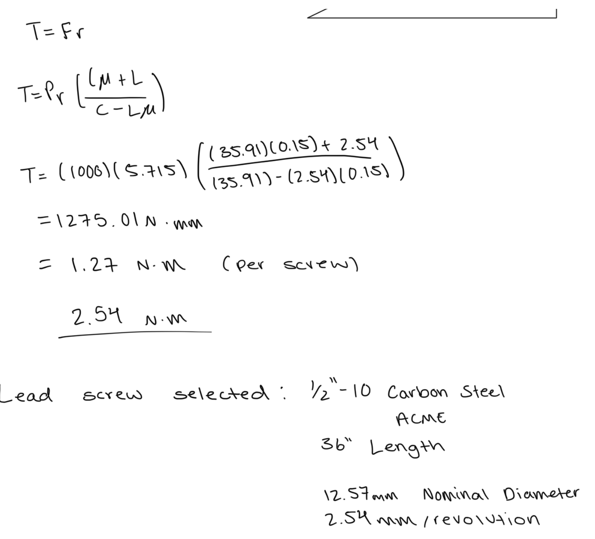

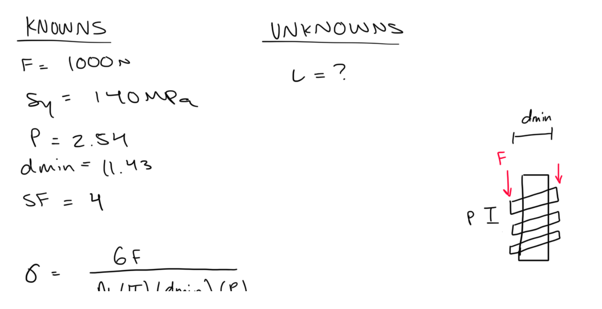

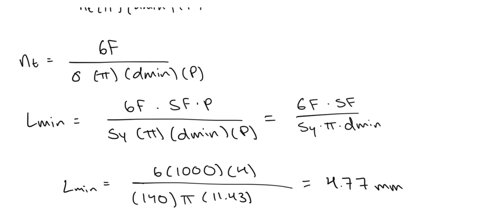

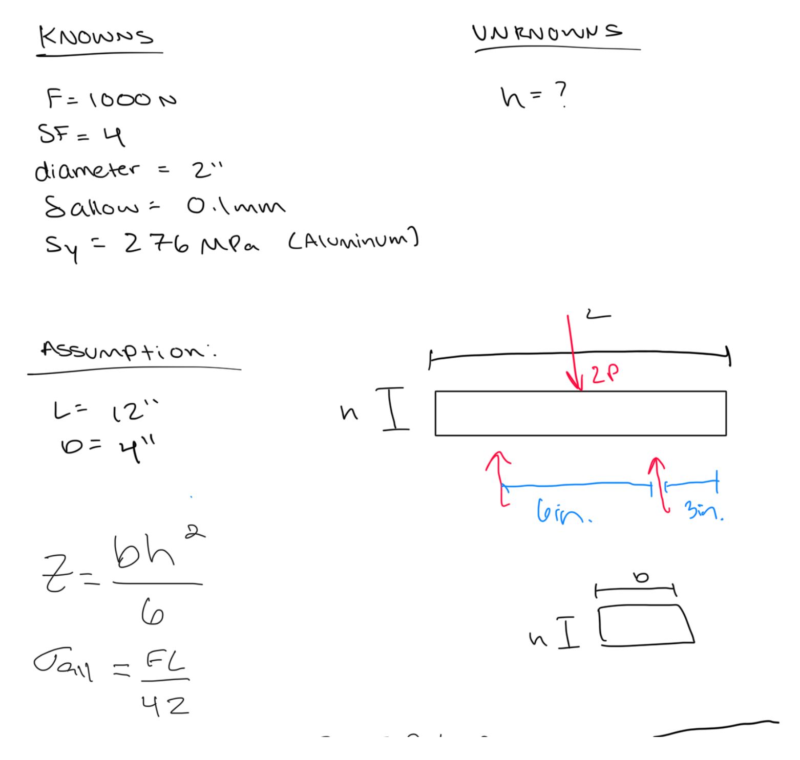

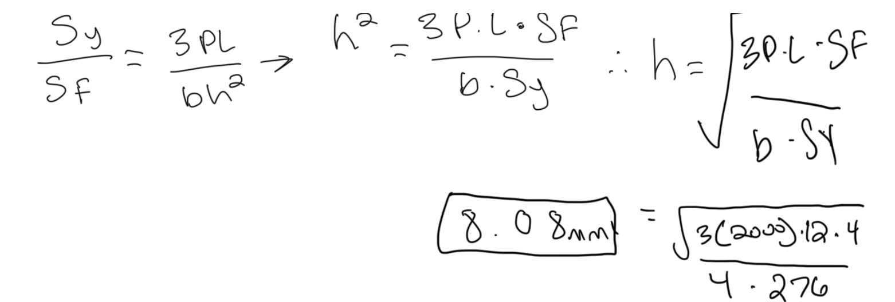

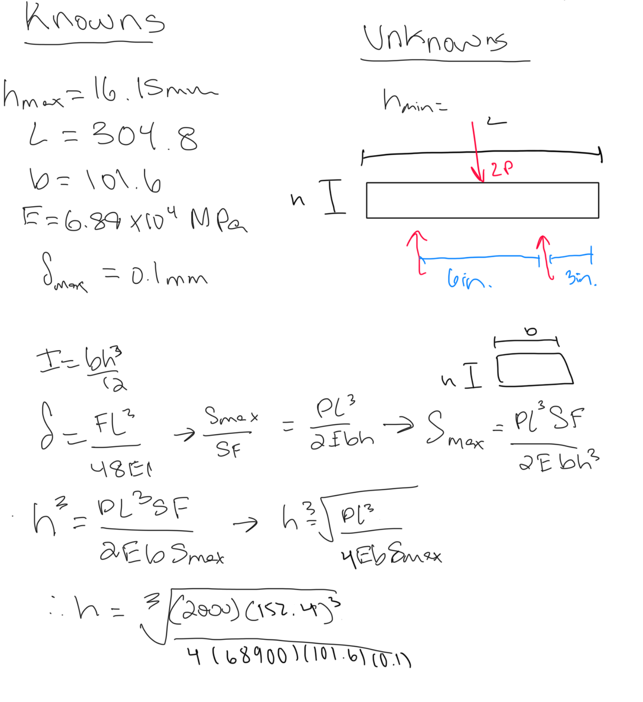

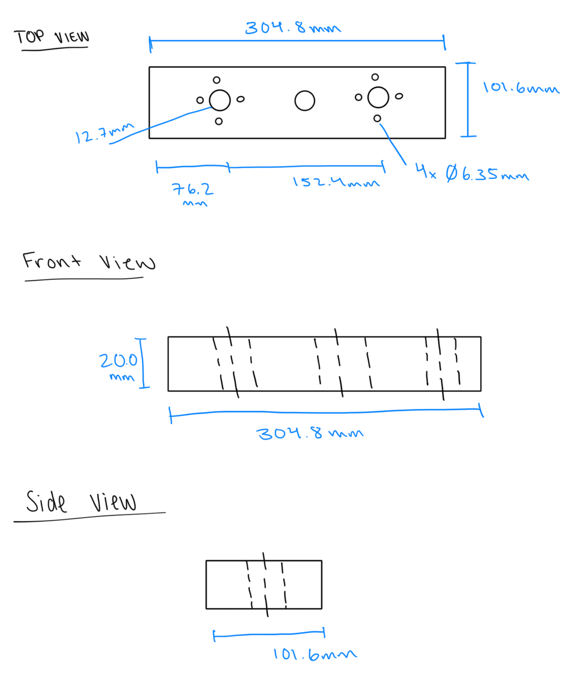

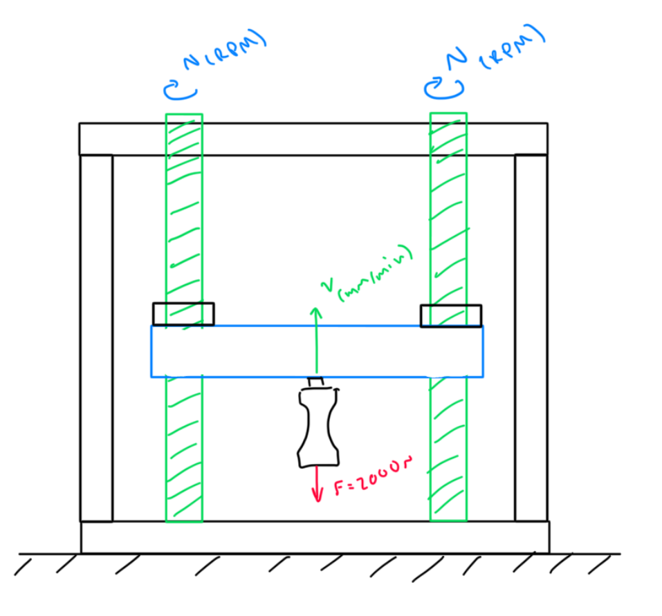

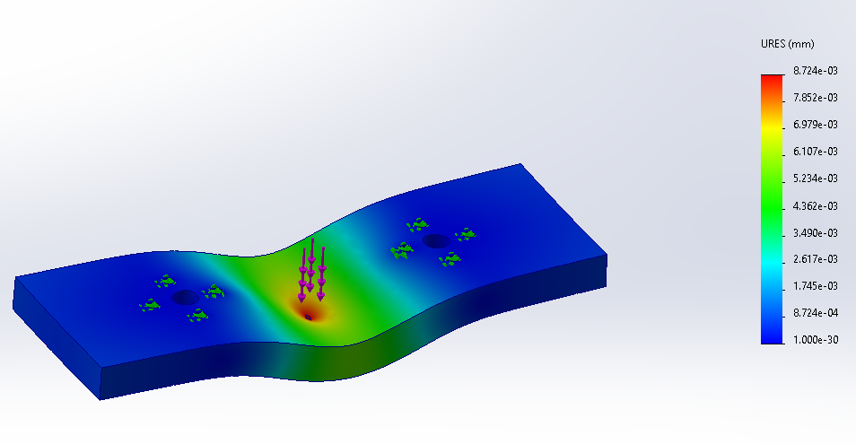

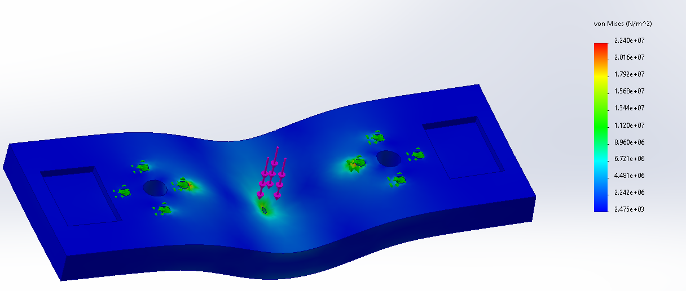

## Decide

## Communicate
