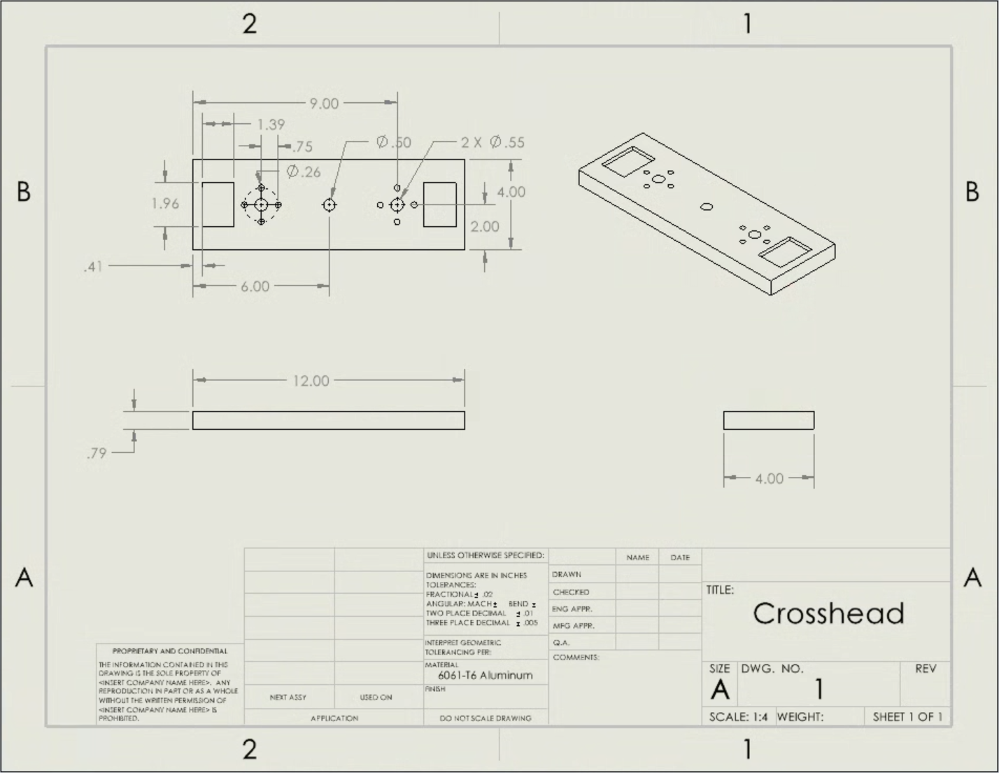

# A10 – Lead Screw Translating System

## Objective
The objective of this assignment is to design a mechanically operated tensile testing system using two lead screws capable of applying a maximum axial tensile load of 2 kN with a controlled crosshead speed of 1–50 mm/min. The design process involves determining the appropriate lead screw diameter, rotational speed, and torque while maintaining a safety factor of 4. Additionally, the project includes selecting suitable nuts and flanges, designing a crosshead that meets strength and deflection requirements, and creating a complete CAD assembly in SolidWorks. The overall goal is to develop a safe, reliable, and accurate tensile testing system while applying engineering calculations, material selection, and mechanical design principles.

## Lead Screw

**Diameter**

We started by dividing the total load between the two lead screws. Using the carbon steel material properties and the required safety factor, we calculated the minimum screw diameter. The notes below show our known values, free-body diagram, and calculations.

**Rotational Speed Range**

Next, we used the screw lead to find the rotational speed needed for the required crosshead movement. The lead tells us how far the nut travels during each full turn of the screw. We used this relationship to calculate the minimum and maximum rotational speeds.

**Torque and Lead Screw Selection**

We calculated the torque needed to turn each lead screw under load. This calculation uses the screw dimensions, load, and friction assumption shown in our notes. We selected a carbon steel Acme lead screw and used its dimensions in the rest of the design.

## Nut and Flange

We used a thread bending stress calculation to find the minimum nut engagement length. The calculation uses the load carried by one screw, the thread dimensions, and the bronze material properties. We then used the flange nut model with the lead screws in our SolidWorks assembly.

## Crosshead Design

**Stress Analysis**

We chose aluminum for the crosshead and modeled it as a beam supported at the two nut locations. The pulling load acts at the center of the crosshead. We used bending stress to calculate a starting thickness based on the dimensions and assumptions in our notes.

**Deflection Analysis**

We also calculated the thickness needed to limit crosshead deflection. We compared the deflection result with the strength result before choosing the thickness for the model. Our selected thickness is shown at the end of the handwritten calculations.

**Multiview Sketches**

We drew top, front, and side views of the crosshead to plan its shape before finishing the CAD model. These sketches show the overall dimensions, lead screw locations, center hole, and mounting hole layout.

## CAD Assembly

We modeled the crosshead in SolidWorks and assembled it with the downloaded lead screws and flange nuts. We used mates to line up the screws with the crosshead holes and position the nuts against the crosshead.

After that, we added the vertical and horizontal frame pieces. We positioned these around the lead screw assembly to create the frame shown below.

## 2157 (FEA)

## Original Crosshead

**Load and Fixtures**

We set up a static simulation using aluminum for the crosshead. We constrained the flange mounting holes because these are where the nuts support the crosshead. We applied the load at the center grip location to represent the pulling force on the crosshead.

**Mesh**

We generated a solid mesh for the crosshead before running the simulation. The image below shows how the part was divided into elements, including the areas around the holes.

**Original Crosshead Results**

The stress plot shows higher stress around the mounting holes and the center load area. The resultant displacement plot shows the largest movement near the center of the crosshead, between the supports.

These results gave us a starting point for comparing the original crosshead with the modified design.

**Finer Mesh Results**

We ran another simulation with a finer mesh to see how the result changed. The maximum resultant displacement stayed close to the earlier result. The image below shows the displacement from the finer mesh run.

**Modified Crosshead**

We added shallow (5mm) pockets near the ends of the crosshead to remove material. We kept the center grip area and the mounting holes in place.

The original crosshead had a mass of 1,702.42 grams, and the optimized crosshead had a mass of 1,652.80 grams. This removed 49.62 grams, which is about 2.91 percent of the original mass.

We ran the simulation again after changing the geometry. The optimized stress plot showed a lower maximum stress than the original results. The image below shows the stress result for the modified crosshead.

**Crosshead Drawing**

## Lessons Learned

Throughout this project, our team gained a better understanding of the engineering design process and how different mechanical components work together in a tensile testing machine. We learned how to select leadscrews based on axial stress, rotational speed, torque, and safety factors. We also learned the importance of selecting compatible components, such as the bronze flange nuts, and verifying that they can withstand the required loads.

One of the most important lessons was understanding how material selection and component dimensions affect the strength and stiffness of a design. When designing the crosshead, we applied bending stress and deflection equations to determine appropriate dimensions while ensuring that the component could support the 2 kN load. We also gained experience using SolidWorks to model components, create assemblies, and evaluate structural performance through finite element analysis (FEA).

Another important lesson was that engineering design requires adjustments and careful verification. Selecting a component based only on its dimensions is not sufficient; its material properties, load capacity, compatibility, and factor of safety must also be considered. Overall, this project improved our understanding of mechanical design, engineering calculations, CAD modeling, and the importance of documenting and justifying design decisions.

## CAD Download Files

[Click here to download lead_screw.SLDPRT](lead_screw.SLDPRT?raw=true)

[Click here to download flange_nut.SLDPRT](flange_nut.SLDPRT?raw=true)

[Click here to download frameheight.SLDPRT](frameheight.sldprt?raw=true)

[Click here to download framewidth.SLDPRT](framewidth.sldprt?raw=true)

[Click here to download Assembly.SLDASM](Assembly.SLDASM?raw=true)

[Click here to download crosshead.SLDPRT](crosshead.SLDPRT?raw=true)

[Click here to download crosshead.SLDDRW](crosshead.SLDDRW?raw=true)

[Click here to download crosshead_optimized.SLDPRT](crosshead_optimized.SLDPRT?raw=true)
