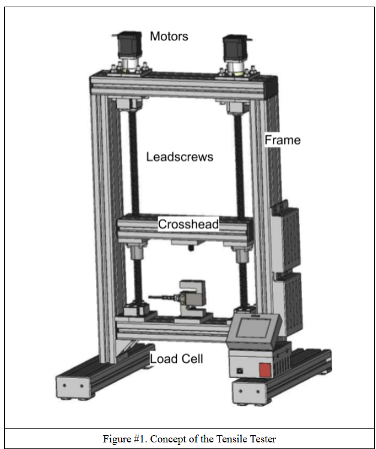
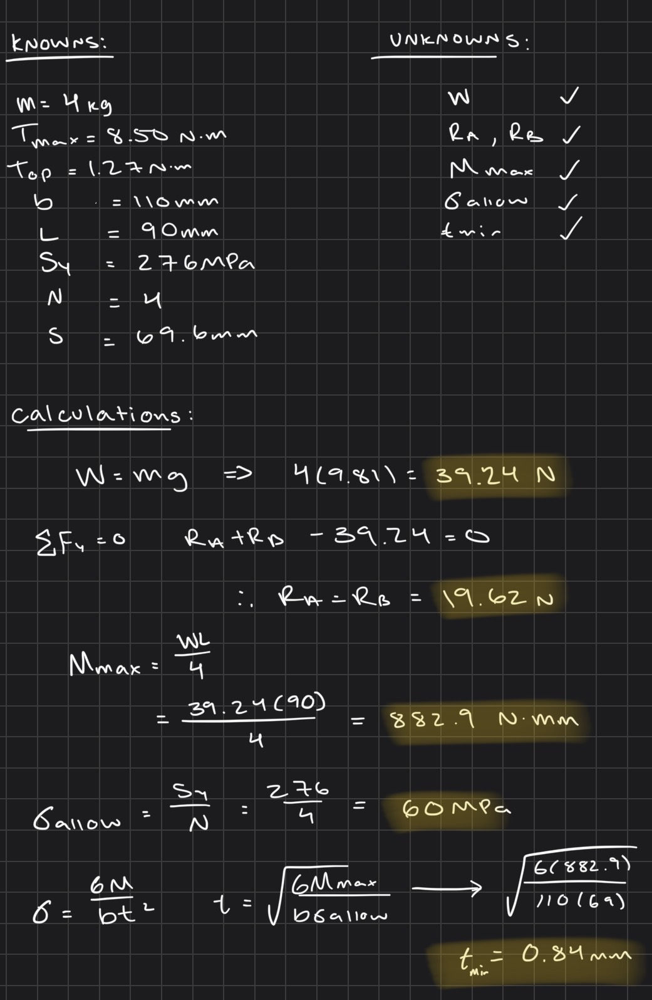
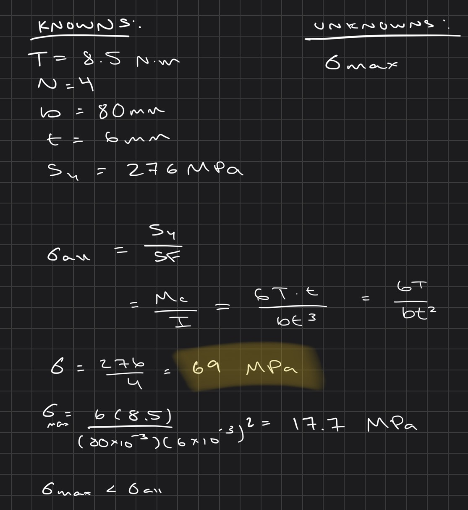
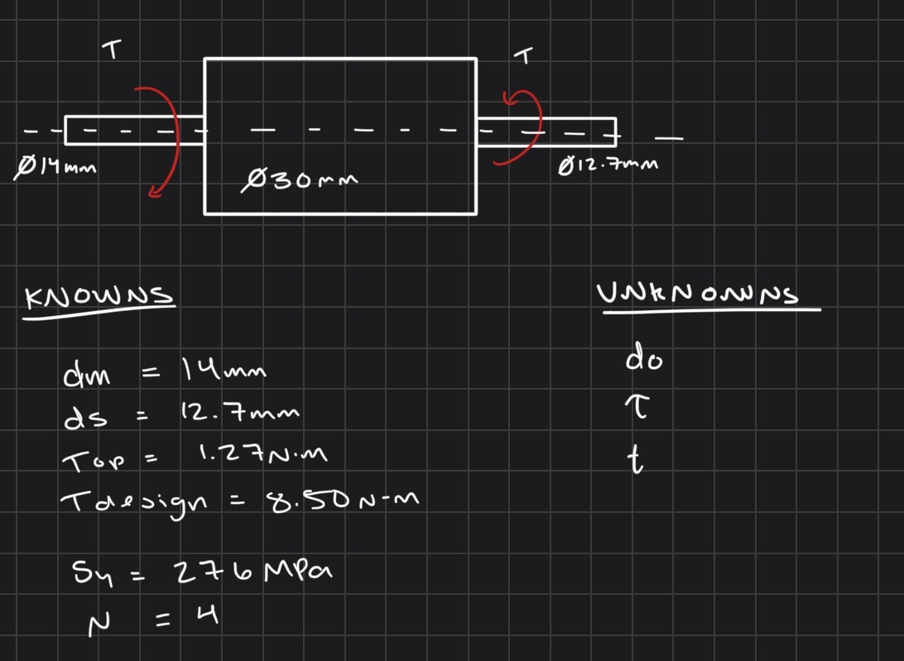
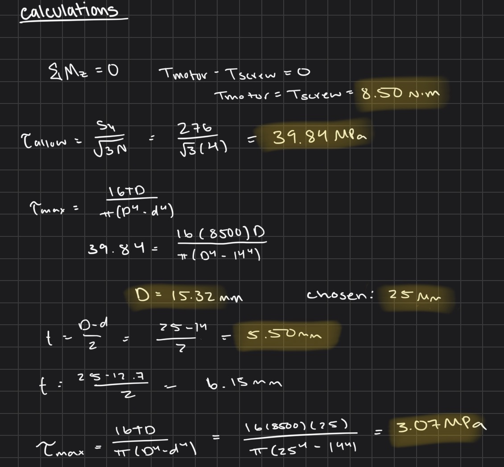
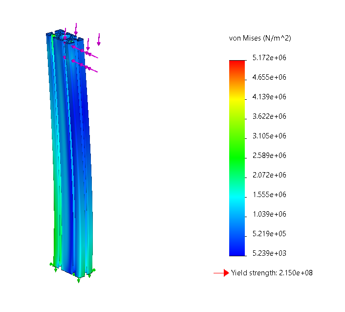
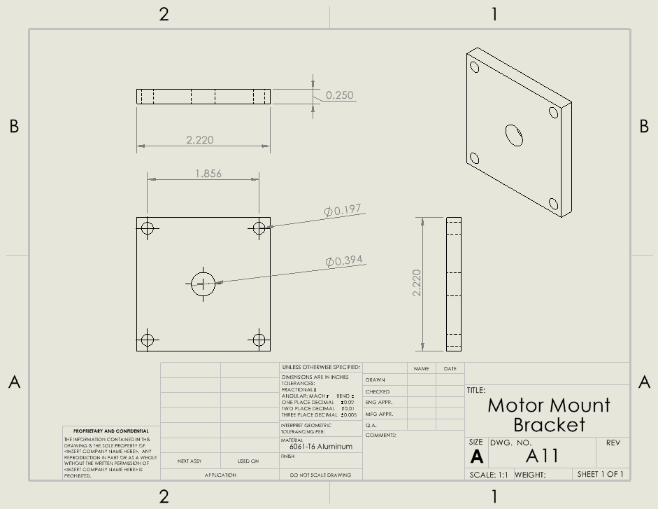
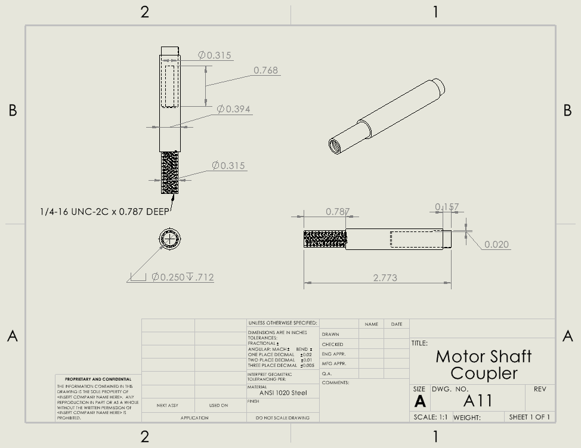
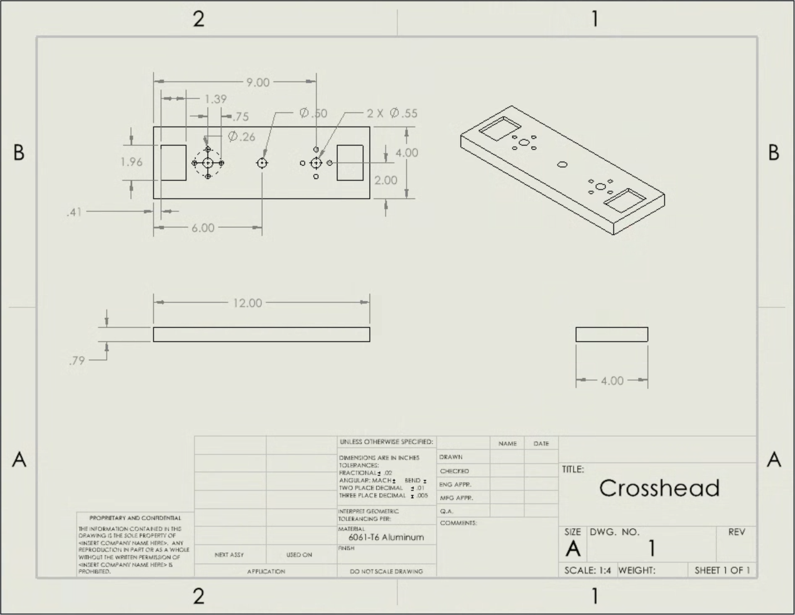

# A11 – Motor Selection

## Objective

For this assignment, we continued designing our tensile tester from the previous assignment. We focused on selecting the motors, designing the motor mounts and couplers, and checking the strength of the frame. We also used SolidWorks Simulation to study how the frame reacts to the applied loads.

## Motor Selection

We selected two NEMA 34 stepper motors from STEPPERONLINE, model 34HS46-5004D1. Each motor is used to rotate one of the lead screws and move the crosshead. We chose these motors because they provide a high holding torque and allow precise control of the crosshead movement.

The motors will be mounted at the top of the frame, directly above the lead screws.

**Motor Mount Design**

We designed a flat aluminum mounting plate to attach each motor to the top horizontal frame. The plate has four mounting holes for the motor and a center opening for the shaft.

We selected 6061-T6 aluminum because it is strong, lightweight, and easy to machine.

We created a free-body diagram showing the motor weight acting downward and the reactions from the two supports. We used this diagram to determine the forces and bending moment acting on the motor mount. 

**Motor Mount Calculations**

We used the motor weight, the distance between supports, and the material strength to calculate the required plate thickness. We included a safety factor of four in our calculations.

After calculating the minimum thickness, we selected a thicker plate to provide additional strength and support for the motor.

## Coupler Design

We designed a coupler to connect each motor shaft to its lead screw. The motor shaft and lead screw have different diameters, so the coupler uses two different bore sizes.

We selected aluminum for the coupler and used the motor torque to determine the required outside diameter and wall thickness.

We created a free-body diagram showing the torque entering the coupler from the motor and the resisting torque from the lead screw.

We used torsional shear stress to calculate the minimum coupler outside diameter. We then selected a larger diameter to provide more material around the shaft openings.

The selected coupler has a 25 mm outside diameter and a minimum wall thickness of 5.5 mm.

## Frame Connection Design

We selected T-slot corner brackets to connect the horizontal frame to the vertical supports. These brackets help keep the frame aligned and resist forces caused by the motors and lead screws.

The bracket shown below was used as a reference for the frame connections.

## Top Horizontal Frame FEA

We used SolidWorks Simulation to test the top horizontal frame under the applied forces. The frame uses an aluminum T-slot extrusion with an 80 mm by 40 mm cross-section.

We used a static study to examine the stress and deformation of the beam.

We applied fixed constraints at the frame connection locations to represent how the horizontal beam is attached to the vertical supports.

We applied forces to represent the loads transferred from the lead screws and motor mounting areas.

After running the simulation, we examined the von Mises stress distribution. The higher stress areas appeared near the supported ends and locations where the loads were applied.

The maximum stress was approximately 24.17 MPa.

We ran another simulation to compare the results. The second simulation produced a maximum stress of approximately 22.42 MPa.

The results showed that the stress remained below the material yield strength for the conditions used in the simulation.

## Engineering Drawings

Table of Costs 

| Item | Quantity | Component | Cost/Item | Total Cost | Purchase Link |
|---|---|---|---|---|---|
| 1 | 2 | NEMA 34 Stepper Motor | $32.61 | $65.22 | [NEMA 34](INSERT_LINK) |
| 2 | 2 | Acme Flange Nut | $179.00 | $358.00 | [Flange Nut](INSERT_LINK) |
| 3 | 2 | Leadscrew | $9.90 | $19.80 | [Leadscrew](INSERT_LINK) |
| 4 | 2 | Motor Mount | $25.00 | $50.00 | — |
| 5 | 1 | Coupler | $25.00 | $25.00 | — |
| 6 | 4 | Bracket | $10.92 | $43.68 | [Bracket](https://www.grainger.com/product/80-20-Inside-Corner-Bracket-Wide-5JRU7) |
| 7 | 4 | T-Slot Frame | $47.91 | $191.68 | [T-Slot Frame](https://www.grainger.com/product/80-20-T-Slot-Framing-System-Profiles-906T77) |
| | | | **Total Cost** | **$753.38** | |

## Lessons Learned

This assignment helped us understand how the different parts of the tensile tester work together. We learned how to use motor torque to design a coupler, how to calculate the thickness of a motor mount, and how to use simulation results to study the strength of the frame.

We also learned that the frame connections and mounting locations affect how forces travel through the structure. Comparing our simulation results helped us understand how changes to the model can affect the stress distribution.

## SolidWorks CAD Files

[Download Motor Coupler Drawing](MotorCoupler.SLDDRW)

[Download Motor Mount Drawing](MotorMount.SLDDRW)

[Download Crosshead Drawing](crosshead.SLDDRW)

[Download Tensile Tester Assembly](A11_Tensile_Tester.SLDASM)

[Download Crosshead](crosshead.SLDPRT)
