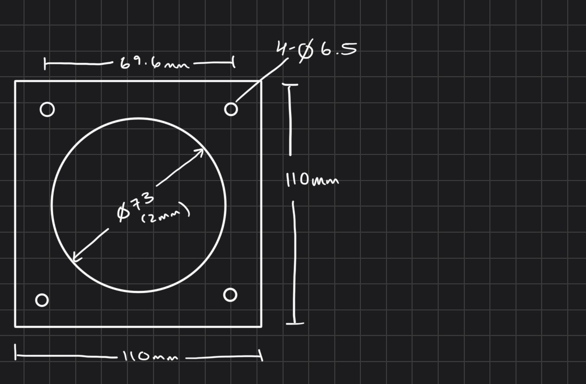
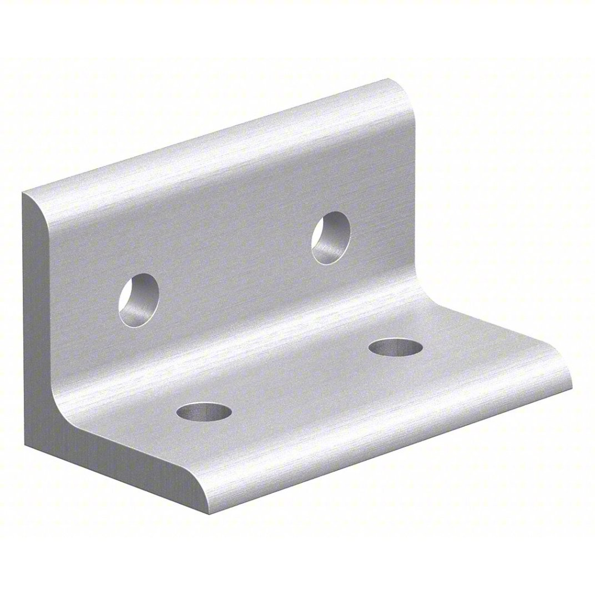
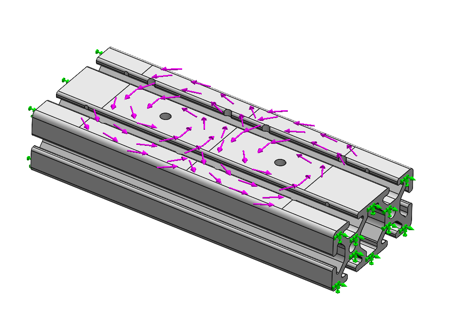
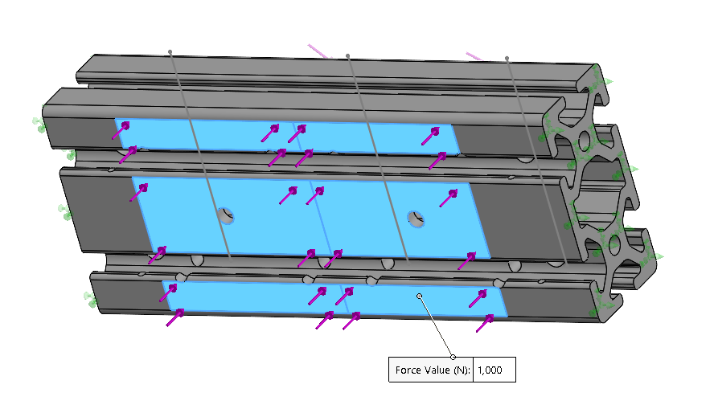

# A11 – Motor Selection

## Objective

For this assignment, we continued designing our tensile tester from the previous assignment. We focused on selecting the motors, designing the motor mounts and couplers, and checking the strength of the frame. We also used SolidWorks Simulation to study how the frame reacts to the applied loads.

## Motor Selection

We selected two NEMA 34 stepper motors from STEPPERONLINE, model 34HS46-5004D1. Each motor is used to rotate one of the lead screws and move the crosshead. We chose these motors because they provide a high holding torque and allow precise control of the crosshead movement.

The motors will be mounted at the top of the frame, directly above the lead screws.

**Motor Mount Design**

We designed a flat aluminum mounting plate to attach each motor to the top horizontal frame. The plate has four mounting holes for the motor and a center opening for the shaft.

We selected 6061-T6 aluminum because it is strong, lightweight, and easy to machine.

We created a free-body diagram showing the motor weight acting downward and the reactions from the two supports. We used this diagram to determine the forces and bending moment acting on the motor mount. 

**Motor Mount Calculations**

We used the motor weight, the distance between supports, and the material strength to calculate the required plate thickness. We included a safety factor of four in our calculations.

After calculating the minimum thickness, we selected a thicker plate to provide additional strength and support for the motor.

## Coupler Design

We designed a coupler to connect each motor shaft to its lead screw. The motor shaft and lead screw have different diameters, so the coupler uses two different bore sizes.

We selected aluminum for the coupler and used the motor torque to determine the required outside diameter and wall thickness.

We created a free-body diagram showing the torque entering the coupler from the motor and the resisting torque from the lead screw.

## Decide
_Reference your concept selection (Pugh matrix) here. How does this design follow from that decision?_

## Communicate
